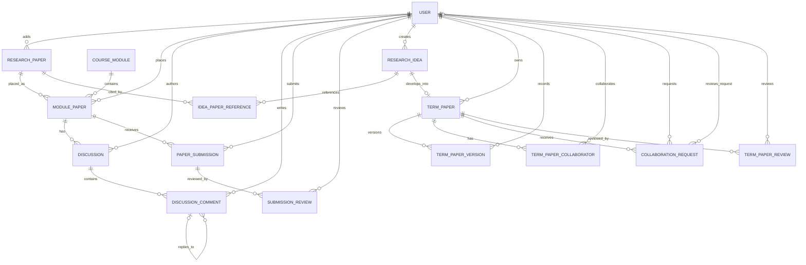

# BTP Final Database Design

**Status:** Finalized logical database design for PostgreSQL implementation  
**Architecture context:** React + TypeScript frontend, Python + FastAPI backend, PostgreSQL database, layered modular monolith  
**Scope:** One course deployment, approximately 500 users initially, with potential for modest future expansion  
**Entity count:** 15

> This document records the agreed logical design and implementation guidance. It does not contain PostgreSQL DDL or ORM code. Items explicitly marked as assumptions or decisions still to confirm must be resolved before implementation; they are not silently decided here.

## 1. Design goals and decisions

### 1.1 Goals

- Keep the database understandable and maintainable for a beginner-to-intermediate team.
- Use PostgreSQL as the relational database.
- Preserve the existing Python paper-ordering backend and layered modular-monolith architecture.
- Separate reusable research-paper metadata from a paper's placement in a course module.
- Keep term-paper files in GitHub or external storage; keep their references and version metadata in PostgreSQL.
- Enforce referential integrity and uniqueness in the database where appropriate, and enforce authorization and workflow rules in the backend.

### 1.2 Finalized design decisions

| Decision | Final choice | Rationale |
|---|---|---|
| Course scope | One course in this deployment | `Course` and `CourseMembership` are omitted; they are unnecessary for the agreed single-course scope. |
| Course modules | Retain `CourseModule` without `course_id` | Module ordering is global for the single-course deployment. |
| User roles | One global role on `User` | A user has one of `professor`, `TA`, or `student`; no course-specific membership entity is retained. |
| Research paper files | Store external URLs/references in the database | Research-paper PDFs are not stored as database blobs. |
| Term-paper files | GitHub is the source of truth | Store repository and commit/version references in the database, not the actual files. |
| Paper placement | `ResearchPaper` and `ModulePaper` are separate | A research paper is reusable metadata; module-specific position, deadline, and submission settings belong to the placement. |
| Paper authors | Deferred | `Author` and `ResearchPaperAuthor` are not part of the current 15-entity model. |
| Submission model | One submission per student per `ModulePaper` | The existing submission can be edited; no separate submission-history entity is included. |
| Reviews | One review per reviewer per target | Multiple reviewers are allowed, with one review record per reviewer for each submission or term paper. |
| Term-paper relationship | At most one term paper per idea | `TermPaper.idea_id` is unique; an idea can have no term paper. |

### 1.3 Technology and scope context

- Frontend: React + TypeScript.
- Backend: Python + FastAPI.
- Database: PostgreSQL.
- Architecture: layered modular monolith.
- Existing Python paper-ordering backend is retained.
- The anticipated scale is about 500 users, with the possibility of two or three additional courses considered earlier. The finalized schema in this document nevertheless follows the explicit decision to design for one course and omit `Course` and `CourseMembership`. If the scope changes to multiple concurrently managed courses, revisit that decision deliberately rather than assuming this schema already supports course isolation.

## 2. Entity inventory

The finalized model contains these 15 entities:

1. `User`
2. `CourseModule`
3. `ResearchPaper`
4. `ModulePaper`
5. `Discussion`
6. `DiscussionComment`
7. `PaperSubmission`
8. `SubmissionReview`
9. `ResearchIdea`
10. `IdeaPaperReference`
11. `TermPaper`
12. `TermPaperVersion`
13. `TermPaperCollaborator`
14. `CollaborationRequest`
15. `TermPaperReview`

Not included in the current model: `Course`, `CourseMembership`, `Author`, and `ResearchPaperAuthor`.

## 3. Entity attributes and key definitions

**Notation:** PK = primary key; FK = foreign key; NN = NOT NULL; UQ = unique; NULL = nullable. Exact SQL data types, generated-key strategy, and final allowed status values are implementation details to settle before DDL.

### 3.1 `User`

| Attribute | Key / constraint | Nullable? | Meaning |
|---|---|---:|---|
| `user_id` | PK | No | Stable user identifier |
| `full_name` | — | No | User's display/full name |
| `email` | UQ, case-insensitive uniqueness | No | Account email |
| `password_hash` | — | Yes | Local authentication hash; nullable if external authentication is used |
| `github_username` | — | Yes | Optional GitHub username |
| `role` | CHECK: `professor`, `TA`, or `student` | No | One global role per user |
| `created_at` | — | No | Account creation timestamp |
| `account_status` | CHECK over allowed states | No | Account lifecycle state; exact allowed states to be finalized |

**Notes**
- Enforce email uniqueness case-insensitively, for example through a unique index on a normalized/lowercase email expression or a suitable case-insensitive type.
- If external authentication is chosen, store a stable provider subject/identifier; do not require `password_hash` for such users.
- A role CHECK limits values but does not itself authorize actions.

### 3.2 `CourseModule`

| Attribute | Key / constraint | Nullable? | Meaning |
|---|---|---:|---|
| `module_id` | PK | No | Module identifier |
| `module_name` | — | No | Module name |
| `module_description` | — | Yes | Optional description |
| `module_order` | UQ | No | Position/order of the module across this single-course deployment |
| `ordering_locked` | DEFAULT `false` | No | Whether module ordering is locked |
| `created_at` | — | No | Creation timestamp |

There is intentionally no `course_id`.

### 3.3 `ResearchPaper`

| Attribute | Key / constraint | Nullable? | Meaning |
|---|---|---:|---|
| `paper_id` | PK | No | Research-paper identifier |
| `title` | — | No | Paper title |
| `abstract` | — | Yes | Optional abstract |
| `publication_year` | — | Yes | Publication year, if known |
| `doi` | UQ when present (normalized DOI; partial unique index) | Yes | DOI identifier |
| `paper_url` | — | No | Main external paper/reference URL |
| `pdf_url` | — | Yes | Optional direct PDF URL |
| `created_at` | — | No | Record creation timestamp |
| `added_by_user_id` | FK → `User.user_id` | No | User who added the paper |

Authors are deferred from this version of the model.

### 3.4 `ModulePaper`

| Attribute | Key / constraint | Nullable? | Meaning |
|---|---|---:|---|
| `module_paper_id` | PK | No | Placement identifier |
| `module_id` | FK → `CourseModule.module_id` | No | Module containing the paper |
| `paper_id` | FK → `ResearchPaper.paper_id` | No | Reusable research-paper record |
| `position` | UQ with `module_id`; positive value | No | Position within the module |
| `added_by_user_id` | FK → `User.user_id` | No | User who placed the paper in the module |
| `added_at` | — | No | Placement timestamp |
| `submission_enabled` | DEFAULT `true` | No | Whether student submissions are enabled for this placement |
| `submission_deadline` | — | Yes | Optional timezone-aware deadline for this placement |

**Constraints**
- UQ (`module_id`, `position`)
- UQ (`module_id`, `paper_id`)
- `position` must be positive.
- `submission_deadline` is per placement. `NULL` means no configured deadline, subject to `submission_enabled`.

**Design rationale:** `ResearchPaper` stores reusable paper metadata. `ModulePaper` represents a paper's placement in a module, so a paper can appear in multiple modules with different positions and submission settings.

### 3.5 `Discussion`

| Attribute | Key / constraint | Nullable? | Meaning |
|---|---|---:|---|
| `discussion_id` | PK | No | Discussion identifier |
| `module_paper_id` | FK → `ModulePaper.module_paper_id` | No | Paper placement being discussed |
| `author_user_id` | FK → `User.user_id` | No | Discussion author |
| `title` | — | No | Discussion title |
| `body` | — | No | Discussion content |
| `created_at` | — | No | Creation timestamp |
| `updated_at` | — | Yes | Last update timestamp |
| `discussion_status` | CHECK over allowed states | No | Discussion lifecycle state; exact states to be finalized |

### 3.6 `DiscussionComment`

| Attribute | Key / constraint | Nullable? | Meaning |
|---|---|---:|---|
| `comment_id` | PK | No | Comment identifier |
| `discussion_id` | FK → `Discussion.discussion_id` | No | Discussion containing the comment |
| `author_user_id` | FK → `User.user_id` | No | Comment author |
| `parent_comment_id` | Nullable self-reference, constrained to same discussion | Yes | Parent comment; NULL indicates a top-level comment |
| `body` | — | No | Comment content |
| `created_at` | — | No | Creation timestamp |
| `updated_at` | — | Yes | Last update timestamp |

**Integrity design for same-discussion parent comments**
- Add UQ (`comment_id`, `discussion_id`) so it can be referenced as a composite key.
- Use a composite self-referencing FK (`parent_comment_id`, `discussion_id`) → (`comment_id`, `discussion_id`).
- This prevents a comment from naming a parent comment that belongs to another discussion.
- If arbitrary-depth nesting is allowed, prevent parent cycles in application logic or with an appropriate database mechanism; a foreign key alone does not prevent cycles.

### 3.7 `PaperSubmission`

| Attribute | Key / constraint | Nullable? | Meaning |
|---|---|---:|---|
| `submission_id` | PK | No | Submission identifier |
| `module_paper_id` | FK → `ModulePaper.module_paper_id` | No | Paper placement being submitted against |
| `student_user_id` | FK → `User.user_id` | No | Student submitting |
| `content` | — | No | Submitted summary/response content |
| `submitted_at` | — | No | Submission timestamp |
| `updated_at` | — | Yes | Last edit timestamp |

**Constraints**
- UQ (`module_paper_id`, `student_user_id`): one submission per student per placement.
- The submission belongs to a `ModulePaper`, not directly to a `ResearchPaper`.
- Edits update the existing submission; a separate submission-history entity is not included.

### 3.8 `SubmissionReview`

| Attribute | Key / constraint | Nullable? | Meaning |
|---|---|---:|---|
| `review_id` | PK | No | Review identifier |
| `submission_id` | FK → `PaperSubmission.submission_id` | No | Submission reviewed |
| `reviewer_user_id` | FK → `User.user_id` | No | Reviewer |
| `grade` | — | Yes | Optional grade; grade scale to be finalized |
| `feedback` | — | Yes | Optional written feedback |
| `reviewed_at` | — | Yes | Review completion timestamp |

**Constraint:** UQ (`submission_id`, `reviewer_user_id`). Multiple reviewers may review a submission, but each reviewer has at most one review record for that submission.

### 3.9 `ResearchIdea`

| Attribute | Key / constraint | Nullable? | Meaning |
|---|---|---:|---|
| `idea_id` | PK | No | Research idea identifier |
| `title` | — | No | Idea title |
| `description` | — | No | Idea description |
| `created_by_user_id` | FK → `User.user_id` | No | Creator |
| `created_at` | — | No | Creation timestamp |
| `updated_at` | — | Yes | Last update timestamp |
| `idea_status` | CHECK over allowed states | No | Idea lifecycle state; exact states to be finalized |

### 3.10 `IdeaPaperReference`

| Attribute | Key / constraint | Nullable? | Meaning |
|---|---|---:|---|
| `idea_paper_reference_id` | PK | No | Association-record identifier |
| `idea_id` | FK → `ResearchIdea.idea_id` | No | Referencing idea |
| `paper_id` | FK → `ResearchPaper.paper_id` | No | Referenced research paper |
| `reference_note` | — | Yes | Optional explanation of the reference |
| `created_at` | — | No | Association creation timestamp |

**Constraint:** UQ (`idea_id`, `paper_id`). This is the junction entity implementing the many-to-many relationship between ideas and research papers.

### 3.11 `TermPaper`

| Attribute | Key / constraint | Nullable? | Meaning |
|---|---|---:|---|
| `term_paper_id` | PK | No | Term-paper project identifier |
| `idea_id` | FK → `ResearchIdea.idea_id`, UQ | No | Idea from which this term paper originates |
| `title` | — | No | Term-paper title |
| `description` | — | Yes | Optional description |
| `owner_user_id` | FK → `User.user_id` | No | Project owner |
| `github_repo_url` | — | No | GitHub repository URL |
| `created_at` | — | No | Creation timestamp |
| `term_paper_status` | CHECK over allowed states | No | Project lifecycle state; exact states to be finalized |

**Relationship rule:** each term paper belongs to exactly one idea, and an idea can have at most one term paper. An idea may have no term paper.

### 3.12 `TermPaperVersion`

| Attribute | Key / constraint | Nullable? | Meaning |
|---|---|---:|---|
| `version_id` | PK | No | Version-record identifier |
| `term_paper_id` | FK → `TermPaper.term_paper_id` | No | Project being versioned |
| `version_number` | UQ with `term_paper_id`; positive value | No | Version sequence number for this project |
| `commit_url` | — | No | Link to a GitHub commit or version |
| `change_summary` | — | Yes | Optional change summary |
| `submitted_by_user_id` | FK → `User.user_id` | No | User who submitted/recorded the version |
| `created_at` | — | No | Version-record timestamp |

**Constraint:** UQ (`term_paper_id`, `version_number`); `version_number` must be positive. A stable commit SHA may be added later if needed, but it is not currently a finalized attribute.

### 3.13 `TermPaperCollaborator`

| Attribute | Key / constraint | Nullable? | Meaning |
|---|---|---:|---|
| `term_paper_collaborator_id` | PK | No | Collaborator association identifier |
| `term_paper_id` | FK → `TermPaper.term_paper_id` | No | Project |
| `user_id` | FK → `User.user_id` | No | Collaborating user |
| `joined_at` | — | No | Join timestamp |
| `collaborator_status` | CHECK over allowed states | No | Collaboration status; exact states to be finalized |

**Constraint:** UQ (`term_paper_id`, `user_id`). The project owner is represented separately by `TermPaper.owner_user_id`; whether the owner must also have a collaborator row remains to be confirmed.

### 3.14 `CollaborationRequest`

| Attribute | Key / constraint | Nullable? | Meaning |
|---|---|---:|---|
| `collaboration_request_id` | PK | No | Request identifier |
| `term_paper_id` | FK → `TermPaper.term_paper_id` | No | Project requested to join |
| `requester_user_id` | FK → `User.user_id` | No | User making the request |
| `request_message` | — | Yes | Optional message |
| `request_status` | CHECK: `pending`, `accepted`, `rejected` | No | Request outcome |
| `requested_at` | — | No | Request timestamp |
| `reviewed_by_user_id` | FK → `User.user_id` | Yes | User who reviewed/resolved the request |
| `reviewed_at` | — | Yes | Resolution timestamp |

**Constraints and rules**
- A partial unique index on (`term_paper_id`, `requester_user_id`) where `request_status = 'pending'` permits historical accepted/rejected requests but at most one pending request for a given user and project.
- A consistency CHECK may require reviewer and review timestamp for resolved requests and require them to be absent while pending, if this matches the final workflow. This consistency rule is recommended for implementation but remains conditional on confirming the workflow.
- Acceptance should be coordinated with collaborator creation/status changes in a transaction.

### 3.15 `TermPaperReview`

| Attribute | Key / constraint | Nullable? | Meaning |
|---|---|---:|---|
| `term_paper_review_id` | PK | No | Review identifier |
| `term_paper_id` | FK → `TermPaper.term_paper_id` | No | Term-paper project reviewed |
| `reviewer_user_id` | FK → `User.user_id` | No | Reviewer |
| `grade` | — | Yes | Optional grade; grade scale to be finalized |
| `feedback` | — | Yes | Optional written feedback |
| `reviewed_at` | — | Yes | Review completion timestamp |

**Constraint:** UQ (`term_paper_id`, `reviewer_user_id`). Multiple reviewers may review a term paper, but each reviewer has at most one review record per term paper.

## 4. Relationships and cardinalities

| Parent / source | Child / target | Cardinality | Meaning |
|---|---|---|---|
| `User` | `ResearchPaper` | 1 : 0..N | A user can add many papers; each paper has one adder |
| `User` | `ModulePaper` | 1 : 0..N | A user can place many papers in modules; each placement has one adder |
| `CourseModule` | `ModulePaper` | 1 : 0..N | A module contains zero or many paper placements |
| `ResearchPaper` | `ModulePaper` | 1 : 0..N | A paper can be placed in multiple modules |
| `ModulePaper` | `Discussion` | 1 : 0..N | A placement can have multiple discussions |
| `User` | `Discussion` | 1 : 0..N | A user can author many discussions |
| `Discussion` | `DiscussionComment` | 1 : 0..N | A discussion contains comments |
| `DiscussionComment` | `DiscussionComment` (parent → child) | 1 : 0..N; each child has 0..1 parent | Supports threaded comments; parent must be in same discussion |
| `ModulePaper` | `PaperSubmission` | 1 : 0..N | A placement can receive many student submissions |
| `User` | `PaperSubmission` | 1 : 0..N | A student can submit to many placements |
| `PaperSubmission` | `SubmissionReview` | 1 : 0..N | A submission can receive multiple reviews |
| `User` | `SubmissionReview` | 1 : 0..N | A reviewer can review many submissions |
| `User` | `ResearchIdea` | 1 : 0..N | A user can create many ideas |
| `ResearchIdea` | `IdeaPaperReference` | 1 : 0..N | An idea can reference many papers |
| `ResearchPaper` | `IdeaPaperReference` | 1 : 0..N | A paper can be referenced by many ideas |
| `ResearchIdea` | `TermPaper` | 1 : 0..1 | An idea may produce zero or one term paper; each term paper has one idea |
| `User` | `TermPaper` (owner) | 1 : 0..N | A user can own many term papers |
| `TermPaper` | `TermPaperVersion` | 1 : 0..N | A project can have many recorded versions |
| `User` | `TermPaperVersion` | 1 : 0..N | A user can submit/record many versions |
| `TermPaper` | `TermPaperCollaborator` | 1 : 0..N | A project has collaborator association rows |
| `User` | `TermPaperCollaborator` | 1 : 0..N | A user can collaborate on multiple projects |
| `TermPaper` | `CollaborationRequest` | 1 : 0..N | A project can receive multiple requests over time |
| `User` | `CollaborationRequest` (requester) | 1 : 0..N | A user can request to join multiple projects |
| `User` | `CollaborationRequest` (reviewer) | 0..1 per request; many requests per user | A user may review/resolve many requests |
| `TermPaper` | `TermPaperReview` | 1 : 0..N | A project can receive multiple reviews |
| `User` | `TermPaperReview` | 1 : 0..N | A reviewer can review many term papers |

### 4.1 Mermaid ER diagram

The diagram summarizes the core FK relationships. The textual entity definitions and constraint tables above are authoritative if diagram notation is ambiguous.

## 5. Functional dependencies and candidate keys

A functional dependency (FD) `X → Y` means that the values of attribute set `X` determine the values of attribute set `Y` for every valid row. The following dependencies reflect the agreed model and ordinary identifier semantics. Business rules that have not been confirmed are not treated as established FDs.

### 5.1 Candidate keys

| Entity | Candidate key(s) |
|---|---|
| `User` | `{user_id}`; normalized `email` |
| `CourseModule` | `{module_id}`; `{module_order}` |
| `ResearchPaper` | `{paper_id}`; DOI only for rows where DOI is present and normalized DOI is unique |
| `ModulePaper` | `{module_paper_id}`; `{module_id, position}`; `{module_id, paper_id}` |
| `Discussion` | `{discussion_id}` |
| `DiscussionComment` | `{comment_id}`; `{comment_id, discussion_id}` is also an alternate unique pair used to support the composite self-FK (it is logically redundant as a candidate key because `comment_id` alone is already unique) |
| `PaperSubmission` | `{submission_id}`; `{module_paper_id, student_user_id}` |
| `SubmissionReview` | `{review_id}`; `{submission_id, reviewer_user_id}` |
| `ResearchIdea` | `{idea_id}` |
| `IdeaPaperReference` | `{idea_paper_reference_id}`; `{idea_id, paper_id}` |
| `TermPaper` | `{term_paper_id}`; `{idea_id}` |
| `TermPaperVersion` | `{version_id}`; `{term_paper_id, version_number}` |
| `TermPaperCollaborator` | `{term_paper_collaborator_id}`; `{term_paper_id, user_id}` |
| `CollaborationRequest` | `{collaboration_request_id}`; pending-only partial uniqueness is not a candidate key for the complete relation because it applies only to rows in the pending state |
| `TermPaperReview` | `{term_paper_review_id}`; `{term_paper_id, reviewer_user_id}` |

**Important qualifications**
- The DOI key applies only when a DOI is present and is normalized; nullable DOI does not identify every row.
- Case-insensitive email uniqueness should be enforced over a normalized value.
- A partial unique index is an enforcement mechanism for a subset of rows, not a conventional candidate key for all `CollaborationRequest` rows.
- The exact account, discussion, idea, collaborator, and term-paper status domains remain to be finalized.

### 5.2 Entity-level functional dependencies

For every entity with a surrogate primary key, the PK determines all non-key attributes in that row. In addition, the agreed alternate unique constraints imply the dependencies below.

| Entity | Functional dependencies supported by the model |
|---|---|
| `User` | `user_id → full_name, email, password_hash, github_username, role, created_at, account_status`; normalized `email → user_id, full_name, password_hash, github_username, role, created_at, account_status` |
| `CourseModule` | `module_id → module_name, module_description, module_order, ordering_locked, created_at`; `module_order → module_id, module_name, module_description, ordering_locked, created_at` |
| `ResearchPaper` | `paper_id → title, abstract, publication_year, doi, paper_url, pdf_url, created_at, added_by_user_id`; for rows with a non-null normalized DOI, `doi → paper_id` and then all paper attributes |
| `ModulePaper` | `module_paper_id → module_id, paper_id, position, added_by_user_id, added_at, submission_enabled, submission_deadline`; `(module_id, position) → paper_id, added_by_user_id, added_at, submission_enabled, submission_deadline`; `(module_id, paper_id) → position, added_by_user_id, added_at, submission_enabled, submission_deadline` |
| `Discussion` | `discussion_id → module_paper_id, author_user_id, title, body, created_at, updated_at, discussion_status` |
| `DiscussionComment` | `comment_id → discussion_id, author_user_id, parent_comment_id, body, created_at, updated_at` |
| `PaperSubmission` | `submission_id → module_paper_id, student_user_id, content, submitted_at, updated_at`; `(module_paper_id, student_user_id) → submission_id, content, submitted_at, updated_at` |
| `SubmissionReview` | `review_id → submission_id, reviewer_user_id, grade, feedback, reviewed_at`; `(submission_id, reviewer_user_id) → review_id, grade, feedback, reviewed_at` |
| `ResearchIdea` | `idea_id → title, description, created_by_user_id, created_at, updated_at, idea_status` |
| `IdeaPaperReference` | `idea_paper_reference_id → idea_id, paper_id, reference_note, created_at`; `(idea_id, paper_id) → idea_paper_reference_id, reference_note, created_at` |
| `TermPaper` | `term_paper_id → idea_id, title, description, owner_user_id, github_repo_url, created_at, term_paper_status`; `idea_id → term_paper_id, title, description, owner_user_id, github_repo_url, created_at, term_paper_status` |
| `TermPaperVersion` | `version_id → term_paper_id, version_number, commit_url, change_summary, submitted_by_user_id, created_at`; `(term_paper_id, version_number) → version_id, commit_url, change_summary, submitted_by_user_id, created_at` |
| `TermPaperCollaborator` | `term_paper_collaborator_id → term_paper_id, user_id, joined_at, collaborator_status`; `(term_paper_id, user_id) → term_paper_collaborator_id, joined_at, collaborator_status` |
| `CollaborationRequest` | `collaboration_request_id → term_paper_id, requester_user_id, request_message, request_status, requested_at, reviewed_by_user_id, reviewed_at`; no full-relation FD from `(term_paper_id, requester_user_id)` is established because multiple historical requests are allowed |
| `TermPaperReview` | `term_paper_review_id → term_paper_id, reviewer_user_id, grade, feedback, reviewed_at`; `(term_paper_id, reviewer_user_id) → term_paper_review_id, grade, feedback, reviewed_at` |

**FD caveat:** The FDs are conditional on the stated uniqueness constraints and the semantics of each field. Before implementation, confirm that no additional real-world dependencies are intended (for example, an external identity provider subject must be unique if used).

## 6. Normalization analysis

Normalization is based on the finalized attributes and dependencies above. The model is designed toward 3NF; implementation review should validate the complete set of business FDs before claiming formal proof of 3NF.

### 6.1 First Normal Form (1NF)

The design follows 1NF because:
- Each attribute stores one value of its intended domain rather than a repeating list of values.
- Multiple paper references for an idea are represented as separate `IdeaPaperReference` rows.
- Multiple collaborators are represented as separate `TermPaperCollaborator` rows.
- Multiple versions are represented as separate `TermPaperVersion` rows.
- Threaded comments are represented as individual `DiscussionComment` rows with a nullable parent reference.
- Reviews are separate rows rather than repeated reviewer/grade columns.
- The database does not store a list of authors or collaborators inside one text field.

**Result:** The model avoids repeating groups and represents repeating relationships as rows.

### 6.2 Second Normal Form (2NF)

2NF requires 1NF and no non-prime attribute to depend on a proper subset of any candidate key. The entities use surrogate PKs, and association entities also enforce natural composite uniqueness where needed.

Examples:
- In `IdeaPaperReference`, `reference_note` and `created_at` describe the association between a particular idea and paper; paper title remains in `ResearchPaper`, and idea title/description remain in `ResearchIdea`.
- In `ModulePaper`, placement-specific attributes such as `position`, `submission_enabled`, and `submission_deadline` belong to the module-paper association, while reusable paper details remain in `ResearchPaper`.
- In `TermPaperCollaborator`, `joined_at` and `collaborator_status` describe a user’s relationship to a particular term paper.
- In review entities, grade and feedback depend on the review target and reviewer combination, not on a reviewer alone or a target alone.

**Result:** The model separates association-specific facts from facts belonging to either associated entity. Final formal verification should check all candidate keys and FDs, including alternate unique keys.

### 6.3 Third Normal Form (3NF)

3NF requires 2NF and, for every non-trivial FD `X → A`, `X` must be a superkey or `A` must be a prime attribute. The design aims to avoid transitive dependencies by keeping each fact with its natural entity.

Examples:
- User attributes (name, email, role, account status) are kept in `User`; other entities store user FKs.
- Module ordering lock and module order are kept in `CourseModule`.
- Reusable paper metadata is stored in `ResearchPaper`; placement-specific configuration is in `ModulePaper`.
- Discussion content is in `Discussion`, while individual comment content and parent relationships are in `DiscussionComment`.
- Submission content is in `PaperSubmission`; grades and feedback for it are in `SubmissionReview`.
- Idea metadata is in `ResearchIdea`; its paper associations are in `IdeaPaperReference`.
- Term-paper project metadata and GitHub repository URL are in `TermPaper`; per-version commit metadata is in `TermPaperVersion`.
- Collaboration request state is kept in `CollaborationRequest`, separate from active collaborator membership rows.
- Review grades and feedback are stored in the relevant review entities rather than duplicated into the project or submission record.

**Result:** The structure is designed to satisfy 3NF under the stated dependencies. Do not treat the presence of surrogate keys alone as proof of 3NF; verify all candidate keys, alternate unique constraints, and domain-specific FDs during implementation review.

## 7. Constraints and integrity rules

### 7.1 Primary keys

Every entity has the PK listed in its attribute table. PKs must be unique and non-null.

### 7.2 Foreign keys

| Child entity / FK | References | Required? |
|---|---|---:|
| `ResearchPaper.added_by_user_id` | `User.user_id` | Yes |
| `ModulePaper.module_id` | `CourseModule.module_id` | Yes |
| `ModulePaper.paper_id` | `ResearchPaper.paper_id` | Yes |
| `ModulePaper.added_by_user_id` | `User.user_id` | Yes |
| `Discussion.module_paper_id` | `ModulePaper.module_paper_id` | Yes |
| `Discussion.author_user_id` | `User.user_id` | Yes |
| `DiscussionComment.discussion_id` | `Discussion.discussion_id` | Yes |
| `DiscussionComment.author_user_id` | `User.user_id` | Yes |
| `DiscussionComment.parent_comment_id` + `discussion_id` | `DiscussionComment.comment_id` + `discussion_id` | Parent nullable; when present must be same discussion |
| `PaperSubmission.module_paper_id` | `ModulePaper.module_paper_id` | Yes |
| `PaperSubmission.student_user_id` | `User.user_id` | Yes |
| `SubmissionReview.submission_id` | `PaperSubmission.submission_id` | Yes |
| `SubmissionReview.reviewer_user_id` | `User.user_id` | Yes |
| `ResearchIdea.created_by_user_id` | `User.user_id` | Yes |
| `IdeaPaperReference.idea_id` | `ResearchIdea.idea_id` | Yes |
| `IdeaPaperReference.paper_id` | `ResearchPaper.paper_id` | Yes |
| `TermPaper.idea_id` | `ResearchIdea.idea_id` | Yes |
| `TermPaper.owner_user_id` | `User.user_id` | Yes |
| `TermPaperVersion.term_paper_id` | `TermPaper.term_paper_id` | Yes |
| `TermPaperVersion.submitted_by_user_id` | `User.user_id` | Yes |
| `TermPaperCollaborator.term_paper_id` | `TermPaper.term_paper_id` | Yes |
| `TermPaperCollaborator.user_id` | `User.user_id` | Yes |
| `CollaborationRequest.term_paper_id` | `TermPaper.term_paper_id` | Yes |
| `CollaborationRequest.requester_user_id` | `User.user_id` | Yes |
| `CollaborationRequest.reviewed_by_user_id` | `User.user_id` | No |
| `TermPaperReview.term_paper_id` | `TermPaper.term_paper_id` | Yes |
| `TermPaperReview.reviewer_user_id` | `User.user_id` | Yes |

`CourseModule` has no `course_id`. All FK deletion/update actions (RESTRICT, CASCADE, SET NULL, etc.) must be chosen explicitly during PostgreSQL implementation; no universal cascade policy has been finalized.

### 7.3 Uniqueness constraints and indexes that enforce uniqueness

| Entity | Unique rule |
|---|---|
| `User` | Case-insensitive unique email |
| `CourseModule` | Unique `module_order` |
| `ResearchPaper` | Unique normalized DOI when DOI is not NULL (partial unique index) |
| `ModulePaper` | Unique (`module_id`, `position`) |
| `ModulePaper` | Unique (`module_id`, `paper_id`) |
| `DiscussionComment` | Unique (`comment_id`, `discussion_id`) to support composite parent FK; `comment_id` remains the PK |
| `PaperSubmission` | Unique (`module_paper_id`, `student_user_id`) |
| `SubmissionReview` | Unique (`submission_id`, `reviewer_user_id`) |
| `IdeaPaperReference` | Unique (`idea_id`, `paper_id`) |
| `TermPaper` | Unique `idea_id` |
| `TermPaperVersion` | Unique (`term_paper_id`, `version_number`) |
| `TermPaperCollaborator` | Unique (`term_paper_id`, `user_id`) |
| `CollaborationRequest` | Partial unique (`term_paper_id`, `requester_user_id`) where status is `pending` |
| `TermPaperReview` | Unique (`term_paper_id`, `reviewer_user_id`) |

### 7.4 CHECK constraints and domain restrictions

| Entity / attribute | Agreed rule |
|---|---|
| `User.role` | One of `professor`, `TA`, `student` |
| `User.account_status` | Must be one of the finalized allowed states (values not yet specified) |
| `CourseModule.ordering_locked` | Non-null; default `false` |
| `ModulePaper.position` | Positive integer |
| `ModulePaper.submission_enabled` | Non-null; default `true` |
| `Discussion.discussion_status` | Must be one of the finalized allowed states (values not yet specified) |
| `DiscussionComment.parent_comment_id` | If non-null, parent comment must belong to same discussion; composite FK |
| `PaperSubmission` | One row per (`module_paper_id`, `student_user_id`) |
| `ResearchIdea.idea_status` | Must be one of the finalized allowed states (values not yet specified) |
| `TermPaper.term_paper_status` | Must be one of the finalized allowed states (values not yet specified) |
| `TermPaperVersion.version_number` | Positive integer |
| `TermPaperCollaborator.collaborator_status` | Must be one of the finalized allowed states (values not yet specified) |
| `CollaborationRequest.request_status` | `pending`, `accepted`, or `rejected` |
| `CollaborationRequest` resolution fields | Optional consistency check to align status with `reviewed_by_user_id` and `reviewed_at`, pending workflow confirmation |
| Review `grade` fields | Nullable; grade range/scale not yet finalized |

Use PostgreSQL `CHECK` constraints for closed status/role domains once the exact values are agreed. A CHECK does not replace authorization logic.

## 8. Index plan

Unique constraints create supporting unique indexes in PostgreSQL. Add indexes on FK columns used in joins/deletes and on common query paths; PostgreSQL does not automatically create indexes on the referencing side of every foreign key.

| Entity | Index / key | Purpose |
|---|---|---|
| `User` | Unique normalized/case-insensitive email | Prevent duplicate account email ignoring case |
| `User` | Optional index on `role` | Add only if role-filtered queries justify it |
| `CourseModule` | Unique `module_order` | Enforce module ordering and support ordered reads |
| `ResearchPaper` | Partial unique normalized DOI index | Prevent duplicate DOI when present |
| `ResearchPaper` | Index on `added_by_user_id` if queried by adder | Support FK joins and adder queries |
| `ModulePaper` | Unique (`module_id`, `position`) | Enforce ordering within module |
| `ModulePaper` | Unique (`module_id`, `paper_id`) | Prevent duplicate paper placement in one module |
| `ModulePaper` | Index on `paper_id` if reverse lookup is common | Find all placements of a paper |
| `ModulePaper` | Index on `added_by_user_id` if queried by adder | Support FK joins and adder queries |
| `Discussion` | Index on `module_paper_id` | Retrieve discussions for a placement |
| `Discussion` | Index on `author_user_id` if needed | Author lookup/FK operations |
| `DiscussionComment` | Index on (`discussion_id`, `created_at`) | Retrieve comments chronologically within a discussion |
| `DiscussionComment` | Composite unique (`comment_id`, `discussion_id`) | Support same-discussion composite self-FK |
| `DiscussionComment` | Index on (`parent_comment_id`, `discussion_id`) if useful for reply retrieval/FK checks | Retrieve replies; validate FK efficiently |
| `PaperSubmission` | Unique (`module_paper_id`, `student_user_id`) | Enforce one submission per student per placement |
| `PaperSubmission` | Index on `student_user_id` | List a student's submissions and support FK joins |
| `SubmissionReview` | Unique (`submission_id`, `reviewer_user_id`) | Enforce one review per reviewer per submission |
| `SubmissionReview` | Index on `reviewer_user_id` | List reviews by reviewer and support FK joins |
| `ResearchIdea` | Index on `created_by_user_id` if queried by creator | Creator lookup/FK joins |
| `IdeaPaperReference` | Unique (`idea_id`, `paper_id`) | Prevent duplicate paper reference for an idea |
| `IdeaPaperReference` | Index on `paper_id` | Reverse lookup: ideas referencing a paper |
| `TermPaper` | Unique `idea_id` | Enforce at most one term paper per idea |
| `TermPaper` | Index on `owner_user_id` | List projects owned by a user |
| `TermPaperVersion` | Unique (`term_paper_id`, `version_number`) | Enforce unique version sequence per project |
| `TermPaperVersion` | Index on `submitted_by_user_id` if queried | User/version lookup and FK joins |
| `TermPaperCollaborator` | Unique (`term_paper_id`, `user_id`) | Prevent duplicate collaborator rows |
| `TermPaperCollaborator` | Index on `user_id` | List projects for a collaborator |
| `CollaborationRequest` | Partial unique (`term_paper_id`, `requester_user_id`) WHERE `request_status = 'pending'` | At most one pending request per user/project |
| `CollaborationRequest` | Index on `requester_user_id` | List requests made by a user |
| `CollaborationRequest` | Index on (`term_paper_id`, `request_status`) if needed | List requests for a project by status |
| `CollaborationRequest` | Index on `reviewed_by_user_id` if needed | List requests reviewed by a user |
| `TermPaperReview` | Unique (`term_paper_id`, `reviewer_user_id`) | Enforce one review per reviewer per project |
| `TermPaperReview` | Index on `reviewer_user_id` | List reviews by reviewer |

Do not add every optional index automatically. Validate the final query patterns and use `EXPLAIN (ANALYZE, BUFFERS)` with representative data after implementation.

## 9. Business rules

### 9.1 Users and roles

- Every user has one global role: `professor`, `TA`, or `student`.
- The model does not support course-specific roles or multiple simultaneous roles.
- Authentication credentials must be handled securely; `password_hash` stores a hash, never a plaintext password.
- Account lifecycle values must be selected before implementation.

### 9.2 Modules and paper ordering

- Modules are globally ordered within this single-course deployment by unique `module_order`.
- Each `ModulePaper` belongs to one module and one research paper.
- A given research paper can be placed in more than one module, but not twice in the same module.
- A paper's `position` is unique within its module.
- `CourseModule.ordering_locked` records whether module ordering is locked. The existing Python paper-ordering backend is preserved; its behavior should be integrated rather than redesigned here.
- Position changes and reordering should be done transactionally to avoid collisions with the unique (`module_id`, `position`) constraint.

### 9.3 Paper metadata and external files

- `ResearchPaper` stores metadata and URLs, not PDF binary content.
- `paper_url` is required in this design; `pdf_url` is optional.
- DOI is optional and unique after normalization when present.
- Research-paper authors are deferred.
- Term-paper content lives in GitHub. PostgreSQL stores `github_repo_url`, commit/version URLs and related metadata, not the files themselves.

### 9.4 Discussions and comments

- A discussion belongs to one `ModulePaper` placement and has one author.
- A comment belongs to one discussion and has one author.
- A comment can optionally reply to another comment in the same discussion.
- The composite self-FK enforces same-discussion parentage; preventing comment cycles requires additional logic if arbitrary nesting is permitted.
- Discussion status values are to be finalized.

### 9.5 Submissions and deadlines

- A student has at most one `PaperSubmission` per `ModulePaper`.
- Editing updates the existing submission; no separate submission history is included.
- Submissions are permitted only when `ModulePaper.submission_enabled = true`.
- If a deadline is configured, submissions/edits must satisfy the deadline rule. The precise boundary behavior (for example, whether a request exactly at the deadline is accepted) must be consistently implemented.
- `submission_deadline` is timezone-aware and belongs to a paper placement.
- `NULL` deadline means no configured deadline, but does not override `submission_enabled = false`.
- The backend must validate submission ownership, enabled state, and deadline on every write. Frontend controls alone are not sufficient.
- Handle deadline checks and concurrent writes consistently; use transactions where needed.

### 9.6 Reviews and grades

- A submission may have multiple reviewers; each reviewer has at most one `SubmissionReview` row for that submission.
- A term paper may have multiple reviewers; each reviewer has at most one `TermPaperReview` row for that project.
- `grade`, `feedback`, and `reviewed_at` are nullable to permit a draft/incomplete review if the workflow needs it.
- Grade scale, permitted values, and whether review records can be drafts must be finalized before implementation.

### 9.7 Research ideas and term papers

- An idea can reference many research papers through `IdeaPaperReference`; a paper can be referenced by many ideas.
- An idea may have zero or one term paper.
- Every term paper must point to exactly one idea.
- A term paper has one owner through `owner_user_id`.
- The owner is separate from collaborator association rows; whether the owner should also have a `TermPaperCollaborator` row is unresolved.
- Term-paper files are hosted in GitHub; the database stores project and version references.
- Version numbers are unique per term paper and positive.

### 9.8 Collaboration requests and membership

- Requests are retained as historical records after acceptance/rejection.
- At most one request can be pending for a given requester and term paper at a time.
- A request's acceptance should be coordinated with the corresponding collaborator membership change in a transaction.
- Who is authorized to approve/reject requests and whether owners, TAs, or professors can resolve them must be specified in the authorization policy.
- Exact collaborator statuses and owner-transfer rules remain to be finalized.

## 10. Authorization and application integrity

Database constraints protect structural integrity; they do not fully implement authorization. Enforce these checks on the backend for every relevant operation.

| Operation | Agreed policy / implementation guidance |
|---|---|
| Manage roles and instructor privileges | Only authorized professor-level administration should assign or change privileged roles. Exact bootstrap/admin policy must be defined. |
| Manage paper/module ordering | Professors/TAs manage paper ordering, subject to the existing ordering-lock behavior. |
| Add/manage research papers | Restrict to the appropriate authorized roles according to the course workflow. |
| Create/edit discussions and comments | Enforce the chosen participation and moderation policy; users must not edit other users' content unless authorized. |
| Submit/edit paper response | Students can create/edit their own submission only while submissions are enabled and within the configured deadline. |
| Review submissions | Only authorized reviewers may create/update reviews; do not allow students to change another person's grade or feedback. |
| Manage research ideas | Enforce ownership and any moderation rules decided for ideas. |
| Create/update term papers | Enforce owner/collaborator and privileged-role permissions. |
| Submit a new term-paper version | Only an authorized owner/collaborator or other explicitly permitted role may record a version. |
| Request collaboration | Enforce requester identity and prevent duplicate pending requests through the partial unique index. |
| Accept/reject collaboration request | Check reviewer authorization and update request status plus collaborator membership atomically. |
| Review term papers | Only authorized reviewers may create/update term-paper reviews. |

Additional integrity guidance:
- Use server-side authorization, not frontend-only role checks.
- Validate that a `student_user_id` or `requester_user_id` is the authenticated user when the action is self-service.
- Use database transactions for multi-row workflows such as request acceptance, reordering, and other updates that must remain consistent.
- Use appropriate concurrency handling for unique-position reordering and deadline-sensitive submissions.
- Choose deletion policies explicitly. Avoid accidental cascading deletion of submissions, reviews, term-paper versions, or historical collaboration requests without a deliberate retention decision.
- Store only password hashes if local passwords are used; never store plaintext passwords.
- Validate URLs and handle external-link availability as application concerns; a URL stored in the DB does not guarantee the external resource will remain available.

## 11. External file and link storage strategy

- Research paper: store bibliographic metadata, `paper_url`, optional `pdf_url`, and optional DOI. Do not store PDF bytes in PostgreSQL.
- Term paper: use GitHub as the file/version source of truth. Store `github_repo_url` on `TermPaper` and `commit_url` per `TermPaperVersion`.
- Store stable references and metadata rather than copying the same external files into the database.
- Public GitHub links are suitable only if the project's privacy and assessment requirements permit public repositories. If private repositories are needed, access control and credential/token handling must be designed separately; do not store long-lived secrets in ordinary URL fields.
- Availability, permissions, and correctness of external links need application-level validation and user-facing error handling.

## 12. Open assumptions and decisions to confirm before implementation

These are intentionally not silently resolved by this document.

1. **Global role model:** Confirm that each user has exactly one global role and never needs to be a TA and student simultaneously.
2. **Single-course scope:** Confirm that a single global module sequence is sufficient. If multiple courses must be isolated, revisit the omitted `Course` and `CourseMembership` design rather than adding ad hoc course IDs.
3. **Status values:** Define allowed states for `User.account_status`, `Discussion.discussion_status`, `ResearchIdea.idea_status`, `TermPaper.term_paper_status`, and `TermPaperCollaborator.collaborator_status`.
4. **Grades:** Define the grade scale, bounds, and whether a review can exist before its grade/feedback is complete.
5. **Deletion behavior:** Choose `ON DELETE` / `ON UPDATE` behavior for every FK, especially for user accounts, papers, submissions, reviews, term-paper versions, and collaboration history.
6. **Owner as collaborator:** Decide whether the term-paper owner must also have a `TermPaperCollaborator` row.
7. **Module-wide versus placement-specific deadlines:** Current design places the deadline on `ModulePaper`. Confirm that no separate module-wide deadline is needed.
8. **Paper URL requirement:** Current design requires `paper_url` even if DOI or `pdf_url` is available. Confirm that this is acceptable.
9. **Collaboration request consistency:** Confirm whether resolved requests require both `reviewed_by_user_id` and `reviewed_at`, and how pending requests represent these fields.
10. **Role assignment/bootstrap:** Define how the initial professor/admin account is created and who may grant or revoke professor/TA roles.
11. **Identity provider:** If external authentication is used, decide the provider and store its stable subject identifier with appropriate uniqueness.
12. **Comment nesting:** Confirm whether arbitrary-depth replies are supported; if yes, prevent cycles.
13. **Repository visibility:** Decide whether term-paper repositories may be public or private and how private access is managed.
14. **Version identifier:** Decide whether storing `commit_url` alone is sufficient or a stable commit SHA should also be stored.
15. **Owner transfer:** Define whether/how a term-paper owner can be changed and who may do it.

## 13. Implementation checklist

Before or during PostgreSQL DDL and ORM implementation:

- [ ] Define PostgreSQL types and generated PK strategy for every entity.
- [ ] Implement PKs, FKs, NOT NULL constraints, alternate unique constraints, and agreed CHECK constraints.
- [ ] Implement case-insensitive unique email and partial unique DOI indexes.
- [ ] Implement the pending-only partial unique collaboration-request index.
- [ ] Implement the composite same-discussion parent-comment FK.
- [ ] Add indexes for frequently queried FK columns and access patterns; do not blindly add every optional index.
- [ ] Decide FK deletion/update actions and retention policy.
- [ ] Finalize status domains and grade rules.
- [ ] Implement backend authorization and validation for all writes.
- [ ] Use transactions for reordering and collaboration acceptance workflows.
- [ ] Implement timezone-consistent deadline validation.
- [ ] Validate external URLs and GitHub repository access rules.
- [ ] Confirm the unresolved assumptions in Section 12.
- [ ] Review all functional dependencies and candidate keys before claiming formal 3NF compliance.
- [ ] Test unique constraints and race conditions with concurrent requests.
- [ ] Use representative query plans to tune indexes after data and access patterns are available.

## 14. Summary of the finalized schema

The design contains 15 entities and intentionally excludes `Course`, `CourseMembership`, `Author`, and `ResearchPaperAuthor`. `CourseModule` is global for the single-course deployment. `ResearchPaper` stores reusable metadata; `ModulePaper` stores placement-specific attributes. Student submissions and reviews are separate entities. Research ideas reference papers through a junction entity and can produce at most one term paper. Term-paper files and version content remain in GitHub, while PostgreSQL stores repository and commit references. The model is structured toward 3NF, with formal validation of all functional dependencies, final status/grade domains, authorization policies, and FK deletion rules still required before implementation.
