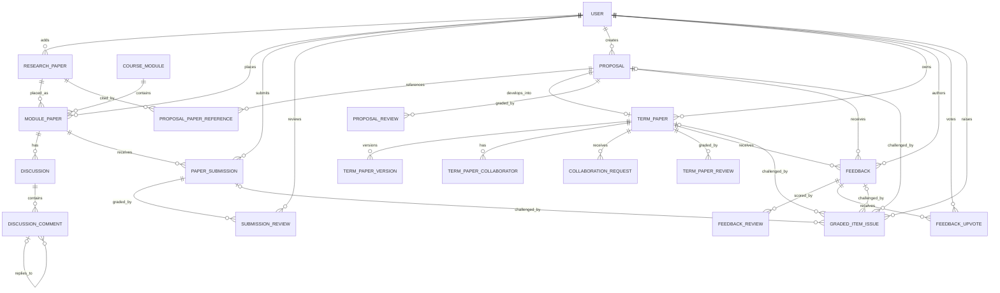

# BTP Final Database Design — Existing and Professor-Suggested Features

**Status:** Revised logical design incorporating the original BTP requirements and the professor-suggested features in the updated course-website documentation  
**Database:** PostgreSQL  
**Backend / architecture context:** Python + FastAPI, layered modular monolith; preserve the existing paper-ordering backend  
**Frontend decision:** The original documentation specifies React + TypeScript and separately suggests exploring HTMX. This is a frontend decision, not a database change.  
**Deployment scope:** One course, with one global module sequence  
**Scale context:** Original documentation states 100–250 members; earlier design discussion considered approximately 500 users and modest expansion. The relational design remains suitable for this scale without adding distributed architecture.

> This is a logical database design, not PostgreSQL DDL. It preserves the previously agreed single-course scope, one global role per user, external research-paper URLs, GitHub as the term-paper source of truth, and the layered modular-monolith architecture. New features are integrated below. Where the professor's notes leave a policy undecided (especially feedback scoring/color tiers and grade objections), the design records a safe, explicit data model and identifies the policy that must still be agreed before implementation.

---

## 1. Requirements covered

### 1.1 Existing requirements

- Three user roles: professor (admin/faculty), TA, and student.
- Professor and TAs can generate a draft ordering of research papers from a topic, add papers, reorder them, and lock the ordering.
- Students view/read ordered research papers module-wise.
- Discussion forums for each research paper, with discussions and comments/replies.
- Students submit summaries/opinions for research papers; professor and TAs view submissions and grade/provide feedback.
- Submission can be disabled and/or closed at a specified date and time.
- Students create research ideas/proposals and link relevant research papers.
- A proposal can be taken up as a term paper; the proposal page shows whether it has been taken and links to the term paper.
- Term-paper projects use an external GitHub repository. The owner can add collaborators; other users can request collaboration; collaborators can submit new versions; users can access/download the latest version.
- Professor and TAs grade/provide feedback on term papers.
- Professor can add/remove TAs.

### 1.2 Professor-suggested additions (from the last pages of the updated documentation)

1. Change the website terminology from **Idea** to **Proposal**.
2. All users can give feedback on proposals and term papers.
3. TAs can score feedback submitted by ordinary users/students.
4. Feedback should have visual distinctions:
   - different colors for TA, faculty/professor, and student feedback;
   - different colors among student feedback authors based on scores earned on their previous feedback;
   - the coloring methodology is explicitly not yet decided.
5. All users can upvote feedback on proposals and term papers.
6. Students can raise an issue/objection against the grade or feedback on all graded items:
   - research-paper summaries/opinions;
   - proposals;
   - term papers;
   - feedback on proposals and term papers.
7. Faculty need a page listing issues/objections. Opening an issue must lead to the context: the relevant submission/proposal/term paper/feedback, its TA grade, and the issue.
8. Faculty can override grades given by TAs.

### 1.3 Original non-functional and design constraints retained

- Target simple-operation latency: at most about 2 seconds, as stated in the original documentation.
- Maintainability and ease of extension are important.
- Availability is required during lecture working hours (the original document mentions approximately 7am–7pm on two days per week).
- Browser portability and responsive UI are required.
- Scalability is not the primary concern, but the system should be extendable.
- Reduce server uploads and prefer local processing where practical.
- Limit external API usage where practical.
- Term-paper files are not stored as database blobs; store GitHub/cloud references.
- Research papers use existing external URLs.

## 2. Decisions retained from the previous database design

| Topic | Retained decision | Reason / implication |
|---|---|---|
| Course scope | One course deployment; no `Course` or `CourseMembership` | Explicitly finalized in the earlier database discussion. |
| Modules | Keep `CourseModule`; no `course_id`; `module_order` is globally unique | A single global module sequence is sufficient for the agreed deployment. |
| Roles | One global `User.role`: `professor`, `TA`, or `student` | The earlier model deliberately did not introduce course memberships or multiple roles per user. Professor and faculty in the new requirements refer to the professor role. |
| Architecture | Layered modular monolith | Preserve the existing Python paper-ordering backend; no database-driven architectural redesign. |
| Research-paper files | Store URLs/metadata, not PDF bytes | Research paper links already exist. |
| Term-paper files | GitHub is the source of truth | PostgreSQL stores repository and commit/version references, not the files themselves. |
| Paper metadata vs placement | Separate `ResearchPaper` and `ModulePaper` | Reusable paper metadata is distinct from module-specific ordering and submission settings. |
| Paper authors | Deferred | `Author` and `ResearchPaperAuthor` remain outside this design. |
| Student summary | One submission per student per `ModulePaper` | Existing submission is edited in place; no submission-history entity was previously approved. |
| Review model | One review row per reviewer per target | Multiple reviewers can exist; one reviewer has one review record per target. |
| Proposal-to-term-paper | At most one term paper per proposal | Preserves the previous `TermPaper.idea_id` unique rule, now using `proposal_id`. |

### 2.1 Terminology update

The website-facing and database terminology is now **Proposal**:
- `ResearchIdea` becomes `Proposal`.
- `IdeaPaperReference` becomes `ProposalPaperReference`.
- `idea_id` becomes `proposal_id` in dependent relationships.
- The proposal status continues to represent whether the proposal is available/taken; the exact status domain is to be finalized.

This is a terminology/domain rename, not a new parallel `Idea` feature. Do not keep both `ResearchIdea` and `Proposal` as separate entities.

## 3. Final entity inventory

The revised design contains **20 entities**.

### Core and existing entities (15, with two renamed)

1. `User`
2. `CourseModule`
3. `ResearchPaper`
4. `ModulePaper`
5. `Discussion`
6. `DiscussionComment`
7. `PaperSubmission`
8. `SubmissionReview`
9. `Proposal` *(renamed from `ResearchIdea`)*
10. `ProposalPaperReference` *(renamed from `IdeaPaperReference`)*
11. `TermPaper`
12. `TermPaperVersion`
13. `TermPaperCollaborator`
14. `CollaborationRequest`
15. `TermPaperReview`

### New entities for professor-suggested features (5)

16. `ProposalReview`
17. `Feedback`
18. `FeedbackReview`
19. `FeedbackUpvote`
20. `GradedItemIssue`

`ProposalReview` records grading of proposals. `Feedback` stores user-authored feedback on a proposal or term paper. `FeedbackReview` stores TA scoring and any faculty override for that feedback. `FeedbackUpvote` stores user votes. `GradedItemIssue` stores student objections and explicit links to the graded item being challenged.

---

## 4. Entity attributes, keys, and constraints

**Notation:** PK = primary key; FK = foreign key; UQ = unique; NN = NOT NULL. Nullable fields are marked `NULL`. Exact SQL types and generated-key strategy are implementation decisions.

### 4.1 `User`

| Attribute | Key / constraint | Nullable? | Meaning |
|---|---|---:|---|
| `user_id` | PK | No | User identifier |
| `full_name` | — | No | Full name |
| `email` | case-insensitive UQ | No | Account email |
| `password_hash` | — | Yes | Local password hash; nullable for external authentication |
| `github_username` | — | Yes | Optional GitHub username |
| `role` | CHECK in `professor`, `TA`, `student` | No | One global role |
| `created_at` | — | No | Account creation timestamp |
| `account_status` | CHECK over finalized states | No | Account lifecycle status |

Notes:
- Professor and faculty are the same role in this model.
- The professor can administer TA roles. TA add/remove can be implemented by changing `User.role`, with appropriate authorization and audit expectations.
- A role CHECK restricts values; it does not enforce permissions.
- If external authentication is used, store a unique stable provider subject identifier (the provider and exact attribute remain to be selected).

### 4.2 `CourseModule`

| Attribute | Key / constraint | Nullable? | Meaning |
|---|---|---:|---|
| `module_id` | PK | No | Module identifier |
| `module_name` | — | No | Name |
| `module_description` | — | Yes | Description |
| `module_order` | UQ | No | Global module order |
| `ordering_locked` | DEFAULT `false` | No | Whether module ordering is locked |
| `created_at` | — | No | Creation timestamp |

No `course_id` is included.

### 4.3 `ResearchPaper`

| Attribute | Key / constraint | Nullable? | Meaning |
|---|---|---:|---|
| `paper_id` | PK | No | Research-paper identifier |
| `title` | — | No | Title |
| `abstract` | — | Yes | Abstract |
| `publication_year` | — | Yes | Publication year |
| `doi` | partial UQ when present, normalized | Yes | DOI |
| `paper_url` | — | No | Existing/main external URL |
| `pdf_url` | — | Yes | Optional direct PDF URL |
| `created_at` | — | No | Creation timestamp |
| `added_by_user_id` | FK → `User.user_id` | No | User who added the paper |

Authors remain deferred.

### 4.4 `ModulePaper`

| Attribute | Key / constraint | Nullable? | Meaning |
|---|---|---:|---|
| `module_paper_id` | PK | No | Placement identifier |
| `module_id` | FK → `CourseModule.module_id` | No | Module |
| `paper_id` | FK → `ResearchPaper.paper_id` | No | Research paper |
| `position` | UQ with `module_id`; CHECK > 0 | No | Position within module |
| `added_by_user_id` | FK → `User.user_id` | No | User who placed it |
| `added_at` | — | No | Placement timestamp |
| `submission_enabled` | DEFAULT `true` | No | Whether student summary submissions are enabled |
| `submission_deadline` | timezone-aware timestamp | Yes | Optional deadline for this placement |

Unique constraints: (`module_id`, `position`) and (`module_id`, `paper_id`).

### 4.5 `Discussion`

| Attribute | Key / constraint | Nullable? | Meaning |
|---|---|---:|---|
| `discussion_id` | PK | No | Discussion identifier |
| `module_paper_id` | FK → `ModulePaper.module_paper_id` | No | Paper placement |
| `author_user_id` | FK → `User.user_id` | No | Author |
| `title` | — | No | Discussion title |
| `body` | — | No | Discussion body |
| `created_at` | — | No | Creation time |
| `updated_at` | — | Yes | Last update |
| `discussion_status` | CHECK over finalized states | No | Status |

### 4.6 `DiscussionComment`

| Attribute | Key / constraint | Nullable? | Meaning |
|---|---|---:|---|
| `comment_id` | PK | No | Comment identifier |
| `discussion_id` | FK → `Discussion.discussion_id` | No | Discussion |
| `author_user_id` | FK → `User.user_id` | No | Author |
| `parent_comment_id` | composite self-FK with `discussion_id` | Yes | Parent; NULL means top-level |
| `body` | — | No | Comment text |
| `created_at` | — | No | Creation time |
| `updated_at` | — | Yes | Last update |

Add UQ (`comment_id`, `discussion_id`) and composite FK (`parent_comment_id`, `discussion_id`) → (`comment_id`, `discussion_id`) to ensure a parent belongs to the same discussion. Prevent cycles in application logic or an appropriate DB mechanism if arbitrary nesting is supported.

### 4.7 `PaperSubmission`

| Attribute | Key / constraint | Nullable? | Meaning |
|---|---|---:|---|
| `submission_id` | PK | No | Submission identifier |
| `module_paper_id` | FK → `ModulePaper.module_paper_id` | No | Paper placement |
| `student_user_id` | FK → `User.user_id` | No | Submitting student |
| `content` | — | No | Summary/opinion content |
| `submitted_at` | — | No | Submission time |
| `updated_at` | — | Yes | Last edit |

UQ (`module_paper_id`, `student_user_id`): one submission per student per paper placement.

### 4.8 `SubmissionReview`

| Attribute | Key / constraint | Nullable? | Meaning |
|---|---|---:|---|
| `review_id` | PK | No | Review identifier |
| `submission_id` | FK → `PaperSubmission.submission_id` | No | Graded submission |
| `reviewer_user_id` | FK → `User.user_id` | No | TA/professor reviewer |
| `grade` | — | Yes | Original review grade |
| `feedback` | — | Yes | Review feedback |
| `reviewed_at` | — | Yes | Review completion time |
| `faculty_override_grade` | — | Yes | Final override grade, if overridden by faculty |
| `faculty_override_by_user_id` | FK → `User.user_id` | Yes | Professor who overrode |
| `faculty_override_at` | — | Yes | Override timestamp |
| `faculty_override_reason` | — | Yes | Reason for override |

UQ (`submission_id`, `reviewer_user_id`). The original TA grade is retained; the faculty override is stored separately rather than destroying the original value. A CHECK should ensure override metadata is internally consistent (grade, actor, and timestamp are either all present or all absent). Only a professor may set override fields.

### 4.9 `Proposal` (renamed from `ResearchIdea`)

| Attribute | Key / constraint | Nullable? | Meaning |
|---|---|---:|---|
| `proposal_id` | PK | No | Proposal identifier |
| `title` | — | No | Proposal title |
| `description` | — | No | Detailed proposal |
| `created_by_user_id` | FK → `User.user_id` | No | Creator |
| `created_at` | — | No | Creation time |
| `updated_at` | — | Yes | Last update |
| `proposal_status` | CHECK over finalized states | No | Includes whether proposal is available/taken; exact values to be finalized |

The prior `idea_status` is renamed `proposal_status`.

### 4.10 `ProposalPaperReference` (renamed from `IdeaPaperReference`)

| Attribute | Key / constraint | Nullable? | Meaning |
|---|---|---:|---|
| `proposal_paper_reference_id` | PK | No | Reference-row identifier |
| `proposal_id` | FK → `Proposal.proposal_id` | No | Proposal |
| `paper_id` | FK → `ResearchPaper.paper_id` | No | Referenced paper |
| `reference_note` | — | Yes | Why the paper is relevant |
| `created_at` | — | No | Creation time |

UQ (`proposal_id`, `paper_id`).

### 4.11 `TermPaper`

| Attribute | Key / constraint | Nullable? | Meaning |
|---|---|---:|---|
| `term_paper_id` | PK | No | Term-paper project |
| `proposal_id` | FK → `Proposal.proposal_id`, UQ | No | Proposal taken up |
| `title` | — | No | Term-paper title |
| `description` | — | Yes | Description |
| `owner_user_id` | FK → `User.user_id` | No | Main/owning user |
| `github_repo_url` | — | No | GitHub repository |
| `created_at` | — | No | Creation time |
| `term_paper_status` | CHECK over finalized states | No | Project status |

UQ `proposal_id`: one proposal can produce at most one term paper. A proposal may have no term paper.

### 4.12 `TermPaperVersion`

| Attribute | Key / constraint | Nullable? | Meaning |
|---|---|---:|---|
| `version_id` | PK | No | Version record |
| `term_paper_id` | FK → `TermPaper.term_paper_id` | No | Project |
| `version_number` | UQ with project; CHECK > 0 | No | Sequence number |
| `commit_url` | — | No | GitHub commit/version URL |
| `change_summary` | — | Yes | Change description |
| `submitted_by_user_id` | FK → `User.user_id` | No | User who recorded/submitted version |
| `created_at` | — | No | Version timestamp |

UQ (`term_paper_id`, `version_number`). GitHub remains source of truth for files.

### 4.13 `TermPaperCollaborator`

| Attribute | Key / constraint | Nullable? | Meaning |
|---|---|---:|---|
| `term_paper_collaborator_id` | PK | No | Membership row |
| `term_paper_id` | FK → `TermPaper.term_paper_id` | No | Project |
| `user_id` | FK → `User.user_id` | No | Collaborator |
| `joined_at` | — | No | Join time |
| `collaborator_status` | CHECK over finalized states | No | Membership status |

UQ (`term_paper_id`, `user_id`). Owner remains separately recorded on `TermPaper`; whether the owner also gets a collaborator row remains unresolved.

### 4.14 `CollaborationRequest`

| Attribute | Key / constraint | Nullable? | Meaning |
|---|---|---:|---|
| `collaboration_request_id` | PK | No | Request identifier |
| `term_paper_id` | FK → `TermPaper.term_paper_id` | No | Project |
| `requester_user_id` | FK → `User.user_id` | No | Requesting user |
| `request_message` | — | Yes | Optional message |
| `request_status` | CHECK in `pending`, `accepted`, `rejected` | No | Request state |
| `requested_at` | — | No | Request time |
| `reviewed_by_user_id` | FK → `User.user_id` | Yes | User who resolved it |
| `reviewed_at` | — | Yes | Resolution time |

Partial UQ (`term_paper_id`, `requester_user_id`) WHERE status = `pending`, allowing historical resolved requests but at most one pending request per user/project.

### 4.15 `TermPaperReview`

| Attribute | Key / constraint | Nullable? | Meaning |
|---|---|---:|---|
| `term_paper_review_id` | PK | No | Review identifier |
| `term_paper_id` | FK → `TermPaper.term_paper_id` | No | Project |
| `reviewer_user_id` | FK → `User.user_id` | No | TA/professor reviewer |
| `grade` | — | Yes | Original review grade |
| `feedback` | — | Yes | Reviewer feedback |
| `reviewed_at` | — | Yes | Review time |
| `faculty_override_grade` | — | Yes | Faculty override, if any |
| `faculty_override_by_user_id` | FK → `User.user_id` | Yes | Professor who overrode |
| `faculty_override_at` | — | Yes | Override time |
| `faculty_override_reason` | — | Yes | Reason |

UQ (`term_paper_id`, `reviewer_user_id`). Preserve the original TA grade and store a professor's override separately. Apply the same consistency CHECK to override fields as in `SubmissionReview`.

### 4.16 `ProposalReview` — new

| Attribute | Key / constraint | Nullable? | Meaning |
|---|---|---:|---|
| `proposal_review_id` | PK | No | Proposal review identifier |
| `proposal_id` | FK → `Proposal.proposal_id` | No | Proposal being graded |
| `reviewer_user_id` | FK → `User.user_id` | No | TA/professor reviewer |
| `grade` | — | Yes | Original grade |
| `feedback` | — | Yes | Review feedback |
| `reviewed_at` | — | Yes | Review time |
| `faculty_override_grade` | — | Yes | Faculty override, if any |
| `faculty_override_by_user_id` | FK → `User.user_id` | Yes | Professor who overrode |
| `faculty_override_at` | — | Yes | Override time |
| `faculty_override_reason` | — | Yes | Reason |

UQ (`proposal_id`, `reviewer_user_id`). The proposal grade is distinct from user-authored feedback about the proposal. Keep both concepts separate.

### 4.17 `Feedback` — new

| Attribute | Key / constraint | Nullable? | Meaning |
|---|---|---:|---|
| `feedback_id` | PK | No | Feedback identifier |
| `author_user_id` | FK → `User.user_id` | No | User who wrote feedback |
| `proposal_id` | FK → `Proposal.proposal_id` | Yes | Proposal receiving feedback |
| `term_paper_id` | FK → `TermPaper.term_paper_id` | Yes | Term paper receiving feedback |
| `content` | — | No | Feedback text |
| `created_at` | — | No | Creation time |
| `updated_at` | — | Yes | Last update |
| `feedback_status` | CHECK over finalized states | No | Optional moderation/lifecycle state |

**Critical CHECK:** exactly one of `proposal_id` and `term_paper_id` must be non-NULL. This single entity supports feedback on either target without allowing an ambiguous or targetless row.

All user roles may author feedback, subject to the product's participation rules. Feedback is not the same as the existing TA/professor review/grade on a proposal or term paper.

### 4.18 `FeedbackReview` — new

| Attribute | Key / constraint | Nullable? | Meaning |
|---|---|---:|---|
| `feedback_review_id` | PK | No | Feedback assessment identifier |
| `feedback_id` | FK → `Feedback.feedback_id` | No | Feedback being scored |
| `reviewer_user_id` | FK → `User.user_id` | No | TA who scores it |
| `score` | — | Yes | Score assigned to the feedback |
| `review_note` | — | Yes | Optional scoring explanation |
| `reviewed_at` | — | Yes | Scoring time |
| `faculty_override_score` | — | Yes | Professor override of the TA score |
| `faculty_override_by_user_id` | FK → `User.user_id` | Yes | Professor who overrode |
| `faculty_override_at` | — | Yes | Override time |
| `faculty_override_reason` | — | Yes | Reason |

UQ (`feedback_id`, `reviewer_user_id`). The scoring scale and whether multiple TAs may independently score one feedback are policy decisions. The unique rule allows one assessment per TA per feedback, and therefore supports multiple TA assessors. The faculty override applies to the selected assessment and preserves its original TA score.

### 4.19 `FeedbackUpvote` — new

| Attribute | Key / constraint | Nullable? | Meaning |
|---|---|---:|---|
| `feedback_upvote_id` | PK | No | Upvote row identifier |
| `feedback_id` | FK → `Feedback.feedback_id` | No | Feedback receiving upvote |
| `user_id` | FK → `User.user_id` | No | User voting |
| `created_at` | — | No | Vote time |

UQ (`feedback_id`, `user_id`): a user can upvote a given feedback once. All users may upvote as stated in the professor's suggestion. Whether authors may upvote their own feedback, and whether users may remove/change a vote, are workflow decisions; deletion of the row can represent vote removal.

### 4.20 `GradedItemIssue` — new

| Attribute | Key / constraint | Nullable? | Meaning |
|---|---|---:|---|
| `issue_id` | PK | No | Issue/objection identifier |
| `raised_by_user_id` | FK → `User.user_id` | No | Student raising the issue |
| `paper_submission_id` | FK → `PaperSubmission.submission_id` | Yes | Summary/opinion being challenged |
| `proposal_id` | FK → `Proposal.proposal_id` | Yes | Proposal being challenged |
| `term_paper_id` | FK → `TermPaper.term_paper_id` | Yes | Term paper being challenged |
| `feedback_id` | FK → `Feedback.feedback_id` | Yes | User feedback being challenged |
| `issue_type` | CHECK in the four target categories | No | `submission`, `proposal`, `term_paper`, or `feedback` |
| `issue_description` | — | No | Student's explanation/objection |
| `issue_status` | CHECK over finalized states | No | Pending, resolved, etc.; exact states to be decided |
| `raised_at` | — | No | Creation time |
| `resolved_by_user_id` | FK → `User.user_id` | Yes | Faculty member resolving |
| `resolved_at` | — | Yes | Resolution time |
| `resolution_note` | — | Yes | Faculty response/outcome |

**Target integrity CHECK:** exactly one of `paper_submission_id`, `proposal_id`, `term_paper_id`, and `feedback_id` must be non-NULL, and it must agree with `issue_type`.

This explicit FK design is preferred over a generic `target_type` + `target_id` pair because PostgreSQL can enforce referential integrity for each target. It also lets the faculty issue page load the correct context using normal joins. The trade-off is four nullable target columns with a strict XOR CHECK.

The issue points to the graded item itself. The current grade/override is retrieved from its associated review row(s), rather than copied into the issue record. This avoids stale duplicate grades if faculty later overrides a grade. If a historical snapshot of the challenged grade is required for audit/legal reasons, add a dedicated issue-event/snapshot design after that requirement is confirmed.

---

## 5. Relationships and cardinalities

| Parent | Child | Cardinality | Meaning |
|---|---|---|---|
| `User` | `ResearchPaper` | 1 : 0..N | User adds papers |
| `User` | `ModulePaper` | 1 : 0..N | User places papers |
| `CourseModule` | `ModulePaper` | 1 : 0..N | Module contains placements |
| `ResearchPaper` | `ModulePaper` | 1 : 0..N | Paper can be placed in multiple modules |
| `ModulePaper` | `Discussion` | 1 : 0..N | Placement has discussions |
| `Discussion` | `DiscussionComment` | 1 : 0..N | Discussion has comments |
| `DiscussionComment` | `DiscussionComment` | 1 : 0..N children; child has 0..1 parent | Threaded replies |
| `ModulePaper` | `PaperSubmission` | 1 : 0..N | Placement receives submissions |
| `User` | `PaperSubmission` | 1 : 0..N | Student submits |
| `PaperSubmission` | `SubmissionReview` | 1 : 0..N | Submission can have multiple reviewers |
| `Proposal` | `ProposalPaperReference` | 1 : 0..N | Proposal references papers |
| `ResearchPaper` | `ProposalPaperReference` | 1 : 0..N | Paper can support multiple proposals |
| `Proposal` | `TermPaper` | 1 : 0..1 | Proposal can be taken into at most one term paper |
| `TermPaper` | `TermPaperVersion` | 1 : 0..N | Project has versions |
| `TermPaper` | `TermPaperCollaborator` | 1 : 0..N | Project has collaborators |
| `TermPaper` | `CollaborationRequest` | 1 : 0..N | Project receives requests |
| `TermPaper` | `TermPaperReview` | 1 : 0..N | Project can have multiple reviews |
| `Proposal` | `ProposalReview` | 1 : 0..N | Proposal can have multiple grading reviews |
| `Proposal` | `Feedback` | 1 : 0..N | Proposal receives feedback rows |
| `TermPaper` | `Feedback` | 1 : 0..N | Term paper receives feedback rows |
| `User` | `Feedback` | 1 : 0..N | User authors feedback |
| `Feedback` | `FeedbackReview` | 1 : 0..N | Feedback can be scored by multiple TAs |
| `Feedback` | `FeedbackUpvote` | 1 : 0..N | Feedback receives upvotes |
| `User` | `FeedbackUpvote` | 1 : 0..N | User upvotes feedback |
| Graded target | `GradedItemIssue` | 1 : 0..N | A graded item can receive issue/objection records |
| `User` | `GradedItemIssue` | 1 : 0..N | Student raises issues; faculty may resolve many |

### 5.1 Mermaid ER diagram

The four optional issue-target links are mutually exclusive per issue (enforced by CHECK). Mermaid's relationship notation does not express that XOR constraint; the entity definition is authoritative.

---

## 6. Functional dependencies and candidate keys

A functional dependency `X → Y` means X determines Y. Every primary key determines all other attributes in its entity. The following alternate keys follow from the unique constraints.

### 6.1 Candidate keys

| Entity | Candidate key(s) |
|---|---|
| `User` | `user_id`; normalized `email` |
| `CourseModule` | `module_id`; `module_order` |
| `ResearchPaper` | `paper_id`; normalized DOI only when non-NULL |
| `ModulePaper` | `module_paper_id`; (`module_id`, `position`); (`module_id`, `paper_id`) |
| `Discussion` | `discussion_id` |
| `DiscussionComment` | `comment_id`; (`comment_id`, `discussion_id`) is an alternate unique pair used by composite FK, though logically redundant as `comment_id` alone is unique |
| `PaperSubmission` | `submission_id`; (`module_paper_id`, `student_user_id`) |
| `SubmissionReview` | `review_id`; (`submission_id`, `reviewer_user_id`) |
| `Proposal` | `proposal_id` |
| `ProposalPaperReference` | `proposal_paper_reference_id`; (`proposal_id`, `paper_id`) |
| `TermPaper` | `term_paper_id`; `proposal_id` |
| `TermPaperVersion` | `version_id`; (`term_paper_id`, `version_number`) |
| `TermPaperCollaborator` | `term_paper_collaborator_id`; (`term_paper_id`, `user_id`) |
| `CollaborationRequest` | `collaboration_request_id`; pending-only partial uniqueness is not a candidate key for all rows |
| `TermPaperReview` | `term_paper_review_id`; (`term_paper_id`, `reviewer_user_id`) |
| `ProposalReview` | `proposal_review_id`; (`proposal_id`, `reviewer_user_id`) |
| `Feedback` | `feedback_id` |
| `FeedbackReview` | `feedback_review_id`; (`feedback_id`, `reviewer_user_id`) |
| `FeedbackUpvote` | `feedback_upvote_id`; (`feedback_id`, `user_id`) |
| `GradedItemIssue` | `issue_id` |

### 6.2 Important functional dependencies

| Entity | Functional dependencies |
|---|---|
| `User` | `user_id → full_name, email, password_hash, github_username, role, created_at, account_status`; normalized `email → user_id` and all user attributes |
| `CourseModule` | `module_id → module_name, module_description, module_order, ordering_locked, created_at`; `module_order → module_id` and all module attributes |
| `ResearchPaper` | `paper_id → title, abstract, publication_year, doi, paper_url, pdf_url, created_at, added_by_user_id`; present normalized DOI → paper record |
| `ModulePaper` | `module_paper_id → all placement attributes`; (`module_id`, `position`) → other placement attributes; (`module_id`, `paper_id`) → other placement attributes |
| `Discussion` | `discussion_id → module_paper_id, author_user_id, title, body, created_at, updated_at, discussion_status` |
| `DiscussionComment` | `comment_id → discussion_id, author_user_id, parent_comment_id, body, created_at, updated_at` |
| `PaperSubmission` | `submission_id → module_paper_id, student_user_id, content, submitted_at, updated_at`; (`module_paper_id`, `student_user_id`) → submission attributes |
| `SubmissionReview` | `review_id → all review attributes`; (`submission_id`, `reviewer_user_id`) → review attributes including override metadata |
| `Proposal` | `proposal_id → title, description, created_by_user_id, created_at, updated_at, proposal_status` |
| `ProposalPaperReference` | `proposal_paper_reference_id → proposal_id, paper_id, reference_note, created_at`; (`proposal_id`, `paper_id`) → association attributes |
| `TermPaper` | `term_paper_id → proposal_id, title, description, owner_user_id, github_repo_url, created_at, term_paper_status`; `proposal_id → term_paper_id` and all term-paper attributes |
| `TermPaperVersion` | `version_id → all version attributes`; (`term_paper_id`, `version_number`) → version attributes |
| `TermPaperCollaborator` | `term_paper_collaborator_id → all membership attributes`; (`term_paper_id`, `user_id`) → membership attributes |
| `CollaborationRequest` | `collaboration_request_id → all request attributes`; no full-relation FD from (`term_paper_id`, `requester_user_id`) because historical resolved requests may repeat |
| `TermPaperReview` | `term_paper_review_id → all review attributes`; (`term_paper_id`, `reviewer_user_id`) → review attributes |
| `ProposalReview` | `proposal_review_id → all review attributes`; (`proposal_id`, `reviewer_user_id`) → review attributes |
| `Feedback` | `feedback_id → author_user_id, proposal_id, term_paper_id, content, created_at, updated_at, feedback_status` |
| `FeedbackReview` | `feedback_review_id → all assessment attributes`; (`feedback_id`, `reviewer_user_id`) → assessment attributes |
| `FeedbackUpvote` | `feedback_upvote_id → feedback_id, user_id, created_at`; (`feedback_id`, `user_id`) → upvote row |
| `GradedItemIssue` | `issue_id → all issue attributes, including exactly one target FK` |

**FD qualifications**
- The DOI dependency applies only to present, normalized DOI values.
- The `Feedback` XOR constraint means each feedback row has exactly one target; neither nullable target alone is a candidate key.
- The `GradedItemIssue` XOR constraint means exactly one graded-item FK is populated.
- Partial uniqueness for pending collaboration requests does not establish an FD for all request rows.
- If a single global reputation/tier is later stored on `User`, it is a derived aggregate of feedback assessment scores and must not be treated as an independent fact unless a cache/materialization strategy is deliberately introduced.

---

## 7. Normalization analysis

The revised schema is designed toward 3NF. As in the previous design, a formal claim requires checking all candidate keys and functional dependencies, not merely observing that tables have surrogate IDs.

### 7.1 First Normal Form (1NF)

- Every field contains a single value of its domain; lists of paper references, collaborators, comments, reviews, and votes are not embedded in a single column.
- `ProposalPaperReference` stores one proposal-paper association per row.
- `TermPaperCollaborator` stores one user-project membership per row.
- `TermPaperVersion` stores one version record per row.
- `Feedback` stores one feedback post per row.
- `FeedbackUpvote` stores one user's vote on one feedback row.
- `FeedbackReview` stores one TA's score/assessment of one feedback row.
- `GradedItemIssue` stores one objection per row and one explicit graded-item target, enforced by XOR.
- Faculty overrides are scalar fields on the corresponding review/assessment record; the original grade/score is not overwritten.

**Result:** No repeating groups or multi-valued attributes are stored in a single relational field.

### 7.2 Second Normal Form (2NF)

2NF requires 1NF and no non-prime attribute to depend on a proper subset of any candidate key.

- In `ProposalPaperReference`, reference note/time depend on the complete proposal-paper association; proposal text and paper metadata remain in their own tables.
- In `ModulePaper`, position, deadline, and submission-enabled status belong to the module-paper placement, not to the reusable paper.
- In `TermPaperCollaborator`, join time/status depend on the complete project-user pair.
- In `FeedbackUpvote`, the row represents the complete feedback-user pair; neither the feedback nor user alone determines the other.
- In `FeedbackReview`, score and review note depend on the feedback-reviewer pair.
- In `SubmissionReview`, `ProposalReview`, and `TermPaperReview`, grade/feedback/override attributes depend on the review target and reviewer combination.
- In `GradedItemIssue`, the issue text/status belongs to the issue record, not to a partial subset of its target relationship.

**Result:** Association-specific facts are stored in association entities; attributes of either parent entity are not duplicated into the junction.

### 7.3 Third Normal Form (3NF)

3NF requires 2NF and every non-trivial FD `X → A` to have X as a superkey or A as a prime attribute.

- User identity and role attributes remain in `User`; child tables hold FKs.
- Module ordering and ordering lock remain in `CourseModule`.
- Reusable research-paper metadata remains in `ResearchPaper`; module placement settings remain in `ModulePaper`.
- Proposal metadata remains in `Proposal`; referenced papers remain in `ProposalPaperReference`.
- Term-paper repository metadata remains in `TermPaper`; commit/version information remains in `TermPaperVersion`.
- Proposal grading is in `ProposalReview`, distinct from user-authored `Feedback`.
- User-authored feedback is in `Feedback`; TA scores and faculty score overrides are in `FeedbackReview`.
- Upvote facts are in `FeedbackUpvote`, not duplicated as counters or user lists in `Feedback`.
- Submission, proposal, and term-paper grading remain in their respective review entities.
- Faculty overrides are stored separately from original TA grades, preserving both facts.
- Objections are stored in `GradedItemIssue`; the current grade is retrieved from the associated review, avoiding duplicated grade values that could become stale.

**Result:** The design is structured toward 3NF under the listed dependencies. Verify all dependencies during implementation. If a cached vote count or feedback reputation score is added for performance, document it as derived/denormalized data and keep it synchronized transactionally or by a reliable refresh process.

---

## 8. Constraints and integrity rules

### 8.1 Primary and foreign keys

All PKs and FKs are listed in the entity sections. Required FKs are NOT NULL unless explicitly nullable. The four `GradedItemIssue` target FKs are individually nullable but exactly one must be populated. `Feedback.proposal_id` and `Feedback.term_paper_id` are individually nullable but exactly one must be populated.

### 8.2 Unique constraints

| Entity | Unique rule |
|---|---|
| `User` | Case-insensitive normalized email |
| `CourseModule` | `module_order` |
| `ResearchPaper` | Normalized DOI when non-NULL (partial unique index) |
| `ModulePaper` | (`module_id`, `position`); (`module_id`, `paper_id`) |
| `DiscussionComment` | (`comment_id`, `discussion_id`) for composite self-FK |
| `PaperSubmission` | (`module_paper_id`, `student_user_id`) |
| `SubmissionReview` | (`submission_id`, `reviewer_user_id`) |
| `ProposalPaperReference` | (`proposal_id`, `paper_id`) |
| `TermPaper` | `proposal_id` |
| `TermPaperVersion` | (`term_paper_id`, `version_number`) |
| `TermPaperCollaborator` | (`term_paper_id`, `user_id`) |
| `CollaborationRequest` | Partial unique (`term_paper_id`, `requester_user_id`) WHERE `request_status = 'pending'` |
| `TermPaperReview` | (`term_paper_id`, `reviewer_user_id`) |
| `ProposalReview` | (`proposal_id`, `reviewer_user_id`) |
| `FeedbackReview` | (`feedback_id`, `reviewer_user_id`) |
| `FeedbackUpvote` | (`feedback_id`, `user_id`) |

### 8.3 CHECK constraints

| Entity | Rule |
|---|---|
| `User.role` | One of `professor`, `TA`, `student` |
| `User.account_status` | Closed set of allowed values to be finalized |
| `CourseModule.ordering_locked` | NOT NULL, default false |
| `ModulePaper.position` | Positive |
| `ModulePaper.submission_enabled` | NOT NULL, default true |
| `Discussion.discussion_status` | Closed set to be finalized |
| `DiscussionComment` | Parent, if present, belongs to same discussion; composite FK |
| `ResearchPaper.doi` | Normalize before partial uniqueness enforcement |
| `PaperSubmission` | Uniqueness per placement/student |
| `Proposal.proposal_status` | Closed set to be finalized |
| `TermPaper.term_paper_status` | Closed set to be finalized |
| `TermPaperVersion.version_number` | Positive |
| `TermPaperCollaborator.collaborator_status` | Closed set to be finalized |
| `CollaborationRequest.request_status` | `pending`, `accepted`, `rejected` |
| Review override fields | Override grade/score, actor, timestamp must be consistently present/absent; override actor must be a professor via backend authorization |
| `Feedback` | Exactly one target: proposal XOR term paper |
| `Feedback.feedback_status` | Closed set to be finalized if status is used |
| `FeedbackReview.score` | Within finalized score range; range not yet specified |
| `FeedbackReview` override fields | Override score, actor, timestamp consistently present/absent |
| `GradedItemIssue.issue_type` | `submission`, `proposal`, `term_paper`, `feedback` |
| `GradedItemIssue` | Exactly one target FK populated and matching `issue_type` |
| `GradedItemIssue.issue_status` | Closed set to be finalized |

### 8.4 Authorization rules are not CHECK constraints

A database CHECK can validate role values and state consistency. It cannot by itself establish that the current authenticated actor is a TA or professor. Enforce these permissions in FastAPI service/application logic, and use transactions for multi-row changes.

---

## 9. Index plan

Unique constraints create supporting unique indexes. Add indexes for common FK joins and query paths. PostgreSQL does not automatically index every referencing FK.

| Entity | Index | Purpose |
|---|---|---|
| `User` | Unique normalized email | Login and duplicate prevention |
| `User` | Optional `role` index | Professor/TA/student filtering if useful |
| `CourseModule` | Unique `module_order` | Ordered module list |
| `ResearchPaper` | Partial unique normalized DOI | Duplicate DOI prevention |
| `ResearchPaper` | `added_by_user_id` if queried | Adder lookup/FK operations |
| `ModulePaper` | Unique (`module_id`, `position`) | Module ordering |
| `ModulePaper` | Unique (`module_id`, `paper_id`) | Prevent duplicate placement |
| `ModulePaper` | `paper_id` | Reverse lookup of placements |
| `Discussion` | `module_paper_id` | Discussions for a paper |
| `DiscussionComment` | (`discussion_id`, `created_at`) | Chronological discussion comments |
| `DiscussionComment` | Composite unique (`comment_id`, `discussion_id`) | Parent integrity |
| `DiscussionComment` | (`parent_comment_id`, `discussion_id`) if needed | Reply lookup |
| `PaperSubmission` | Unique (`module_paper_id`, `student_user_id`) | One submission per student/placement |
| `PaperSubmission` | `student_user_id` | Student's submissions |
| `SubmissionReview` | Unique (`submission_id`, `reviewer_user_id`) | One review per reviewer |
| `SubmissionReview` | `reviewer_user_id` | Reviewer queue/history |
| `Proposal` | `created_by_user_id` | Creator filtering |
| `Proposal` | `proposal_status` if list filters justify it | Available/taken proposal search |
| `ProposalPaperReference` | Unique (`proposal_id`, `paper_id`) | Duplicate prevention |
| `ProposalPaperReference` | `paper_id` | Reverse paper-to-proposal lookup |
| `TermPaper` | Unique `proposal_id` | At most one term paper per proposal |
| `TermPaper` | `owner_user_id` | Owner's project list |
| `TermPaperVersion` | Unique (`term_paper_id`, `version_number`) | Version ordering |
| `TermPaperVersion` | `submitted_by_user_id` if queried | Version submitter lookup |
| `TermPaperCollaborator` | Unique (`term_paper_id`, `user_id`) | No duplicate membership |
| `TermPaperCollaborator` | `user_id` | User's collaborative projects |
| `CollaborationRequest` | Partial unique pending pair | One pending request per user/project |
| `CollaborationRequest` | `requester_user_id` | Requests made by a user |
| `CollaborationRequest` | (`term_paper_id`, `request_status`) | Owner's request queue |
| `TermPaperReview` | Unique (`term_paper_id`, `reviewer_user_id`) | One review per reviewer/project |
| `TermPaperReview` | `reviewer_user_id` | Reviewer's queue/history |
| `ProposalReview` | Unique (`proposal_id`, `reviewer_user_id`) | One review per reviewer/proposal |
| `ProposalReview` | `reviewer_user_id` | TA/professor proposal grading queue |
| `Feedback` | (`proposal_id`, `created_at`) | Proposal feedback list |
| `Feedback` | (`term_paper_id`, `created_at`) | Term-paper feedback list |
| `Feedback` | `author_user_id` | User's feedback history |
| `FeedbackReview` | Unique (`feedback_id`, `reviewer_user_id`) | One score per TA per feedback |
| `FeedbackReview` | `reviewer_user_id` | TA scoring queue |
| `FeedbackUpvote` | Unique (`feedback_id`, `user_id`) | Prevent duplicate votes |
| `FeedbackUpvote` | `user_id` | User's voting history |
| `GradedItemIssue` | (`issue_status`, `raised_at`) | Faculty issue inbox |
| `GradedItemIssue` | `raised_by_user_id` | Student's objections |
| `GradedItemIssue` | Each target FK (partial index WHERE NOT NULL) | Context lookup and FK operations |
| `GradedItemIssue` | `resolved_by_user_id` if queried | Faculty resolution history |

Use optional indexes only when justified by query patterns. Validate with representative data and `EXPLAIN (ANALYZE, BUFFERS)`. For a small cohort, a straightforward indexed relational model should be sufficient; avoid premature caching or API dependencies.

---

## 10. Business rules and workflow integrity

### 10.1 Roles and administration

- Each user has one global role.
- Professor is the faculty/admin role.
- Professor can add/remove TAs by changing their role; enforce that only a professor can do so.
- Students must not be able to assign themselves TA/professor roles.
- Define the initial professor bootstrap process securely.

### 10.2 Paper ordering and reading

- Modules are globally ordered.
- A paper can appear in multiple modules, but once per module.
- Position is unique per module.
- Professor/TA paper ordering actions must respect `ordering_locked`.
- Generate-order backend integration remains as previously decided; the schema stores final placements/order, not the generation algorithm or API payloads.
- Perform reorder operations transactionally to avoid unique-position collisions.

### 10.3 Summary/opinion submissions

- One submission per student per `ModulePaper`.
- Students may edit their own existing submission only while enabled and within the configured deadline.
- `submission_deadline` is timezone-aware; NULL means no configured deadline.
- Backend validates identity, `submission_enabled`, and deadline on every write.
- The submission is a graded item; faculty objections point to the `PaperSubmission` row and retrieve its review/grade.

### 10.4 Proposals

- Use the name Proposal throughout the application and schema.
- Proposal creators link research papers through `ProposalPaperReference`.
- Proposal status communicates whether it is available/taken.
- A proposal can produce at most one term paper.
- Proposal grade/review (`ProposalReview`) is separate from public/user-authored feedback (`Feedback`).

### 10.5 Term papers and collaboration

- Term-paper files live in GitHub; DB stores repository and commit references.
- Owner controls collaborator admission; collaboration requests are stored as history.
- At most one pending request per requester/project.
- Accepting a request and adding/updating collaborator membership should occur in one transaction.
- Collaborators may submit new versions according to backend authorization.
- Latest version is determined by project version sequence or authoritative GitHub commit reference; choose a consistent policy.
- Professor/TAs grade term papers using `TermPaperReview`.
- The original TA grade remains visible/auditable when a faculty override is entered.

### 10.6 User-authored feedback on proposals and term papers

- All roles may create feedback on either a proposal or a term paper.
- Each feedback row targets exactly one proposal or one term paper.
- Feedback content is distinct from instructor review/grade content.
- All roles may upvote feedback.
- A user may upvote a feedback item once, enforced by unique (`feedback_id`, `user_id`).
- Upvote count can be calculated with `COUNT(*)` from `FeedbackUpvote`; do not store a manually incremented counter as the source of truth.
- Whether users may upvote their own feedback and whether votes can be removed must be decided.

### 10.7 TA scoring and feedback coloring

- TAs score user-authored feedback using `FeedbackReview`.
- Preserve the score and the identity/time of the TA reviewer.
- Faculty may override a TA score; preserve the original TA score and store override separately.
- **Do not store a color as the source of truth.** The documentation says coloring depends on role and (for students) scores earned on previous feedback. Color is presentation derived from:
  1. role (`professor`, `TA`, `student`); and
  2. a student feedback-score aggregate/tier calculated from their prior `FeedbackReview` records, using the effective score (faculty override if present, otherwise TA score).
- The exact aggregate (average, sum, recent window, weighted score), thresholds, tie/missing-score handling, and colors are not specified in the professor's notes. Decide this methodology before implementing the color logic.
- If performance later requires caching a user's tier, treat it as derived data, define invalidation/update rules, and do not let it become inconsistent with the underlying assessments.

### 10.8 Graded-item issues / objections

- Only students may raise objections under the professor's stated requirement.
- Supported targets are exactly: paper summary/opinion, proposal, term paper, and user-authored feedback.
- An issue row must target exactly one item.
- The faculty issue inbox filters `GradedItemIssue` rows by status/time.
- The issue detail view joins to the target and its review/assessment to show the item, TA grade/feedback, issue text, and (if applicable) faculty override.
- The issue should not copy the current grade into its own columns; the current grade is derived from the review row. This avoids stale values.
- Only faculty may resolve issues and override grades.
- Define whether a student can raise multiple objections for the same graded item, whether an issue can be withdrawn, and the resolution workflow.
- The current schema allows multiple issue rows for one target because no one-issue-per-target rule was stated.

### 10.9 Faculty grade override

- Faculty may override TA grades for summary/opinion submissions, proposals, and term papers.
- Faculty may override TA scores for user-authored feedback, because feedback is also a graded item in the professor's list and the faculty override rule is stated broadly.
- Keep original TA value and faculty override value separately.
- Effective value shown to users is faculty override if present; otherwise the TA value.
- Record who overrode, when, and why.
- Backend must verify `User.role = professor`; do not rely on UI hiding controls.
- Override changes and issue resolution should be transactional if they are part of one workflow.
- The documentation does not specify whether professors can override another professor's grade; the policy should be explicitly decided. A safe default is to restrict the override operation to faculty and record the actor, while the product owner decides whether the original reviewer role matters.

---

## 11. Authorization matrix

| Action | Student | TA | Professor / faculty |
|---|---:|---:|---:|
| View ordered papers | Yes | Yes | Yes |
| Add/reorder/lock papers | No | Yes | Yes |
| Generate draft paper order | No | Yes | Yes |
| Submit/edit own summary | Yes, while enabled and before deadline | Not as student under single-role model | Not as student under single-role model |
| Grade summary submissions | No | Yes | Yes |
| Create proposal | Yes | Allowed only if product policy permits all users | Allowed only if product policy permits all users |
| Give feedback on proposal/term paper | Yes | Yes | Yes |
| Score user feedback | No | Yes | Yes, subject to scoring policy |
| Upvote feedback | Yes | Yes | Yes |
| Raise issue/objection | Yes | No, unless later policy expands it | No, unless later policy expands it |
| View/manage faculty issue inbox | No | No | Yes |
| Resolve issue | No | No | Yes |
| Override TA grade/feedback score | No | No | Yes |
| Create/own term paper | Yes | Yes only if product policy permits; role remains single | Yes only if product policy permits |
| Approve collaboration requests as project owner | If owner | If owner | If owner |
| Add/remove TAs | No | No | Yes |

The original requirements state students create proposals and term papers, and all users can provide feedback. The table leaves creation by TA/professor as a product permission to confirm where the original requirements do not explicitly grant it. Regardless of UI, all writes require backend authorization.

---

## 12. Issue-to-context mapping

The faculty issue page must route to the correct context. The schema supports this with explicit target FKs:

| `issue_type` | Target FK | Context to show | Grade source |
|---|---|---|---|
| `submission` | `paper_submission_id` | Paper summary/opinion, related research paper/module, student, issue | `SubmissionReview` |
| `proposal` | `proposal_id` | Proposal description/references, creator, issue | `ProposalReview` |
| `term_paper` | `term_paper_id` | Term-paper details/repository/latest version, owner, issue | `TermPaperReview` |
| `feedback` | `feedback_id` | Feedback content, its proposal or term-paper target, author, issue | `FeedbackReview` |

When there are multiple TA reviews, the faculty page needs a defined display/selection policy (for example, show all reviewer grades). The schema permits multiple reviewers and does not silently choose one.

---

## 13. Indexes and query patterns for the new features

In addition to the baseline index plan:

- `ProposalReview`: unique (`proposal_id`, `reviewer_user_id`) and index `reviewer_user_id` for TA grading queue.
- `Feedback`: indexes on (`proposal_id`, `created_at`) and (`term_paper_id`, `created_at`) for target pages; index `author_user_id` for author history.
- `FeedbackReview`: unique (`feedback_id`, `reviewer_user_id`), index `reviewer_user_id` for TA scoring queue.
- `FeedbackUpvote`: unique (`feedback_id`, `user_id`); index `user_id` for user's vote history. The unique index's leading `feedback_id` also supports feedback vote counts.
- `GradedItemIssue`: index (`issue_status`, `raised_at`) for faculty inbox; index `raised_by_user_id` for student issue history; partial indexes on each target FK where not NULL; optional index `resolved_by_user_id`.
- Existing review entities: indexes on reviewer FKs and unique target-reviewer keys.
- If a feedback author reputation/tier query becomes frequent, index `Feedback.author_user_id`, `FeedbackReview.feedback_id`, and `FeedbackReview.reviewer_user_id`. Aggregate scoring should be benchmarked before adding a cache.

---

## 14. Normalization impact of new features

The new entities preserve the prior normalization approach:
- `Feedback` is independent content, not a repeating field on `Proposal` or `TermPaper`.
- `FeedbackUpvote` is a many-to-many association between users and feedback; it avoids arrays of voter IDs or a denormalized voter list.
- `FeedbackReview` stores scoring as a separate reviewer-feedback relationship.
- `ProposalReview` separates proposal grading from proposal metadata and from user feedback.
- `GradedItemIssue` stores objection-specific facts once and references the target through FKs. It does not duplicate proposal text, term-paper details, feedback text, or current grade.
- Faculty override values are recorded alongside the relevant review/assessment because they describe an alternate authoritative grade for that review. Original values remain available.
- Color tier and vote count are derived values, not duplicated source-of-truth attributes.

The schema is designed toward 3NF, subject to confirming the functional dependencies and score/reputation policy.

---

## 15. External file and API strategy

- Research papers: retain external `paper_url` and optional `pdf_url`; no PDF blobs in PostgreSQL.
- Term papers: retain `github_repo_url` and `commit_url`; GitHub is the file/version source of truth.
- Feedback, votes, grades, objections, and relational metadata are small records stored in PostgreSQL.
- The professor's instruction to reduce server uploads supports keeping files in GitHub/external storage and processing text locally where practical. It does not justify omitting feedback/grade/issue records from the database.
- Limit external APIs where practical. The database does not require an external API for feedback, upvotes, scoring, objections, or grade overrides.
- If GitHub API integration is used to retrieve latest versions or manage collaborators, keep credentials outside ordinary DB URL fields and scope permissions carefully.

---

## 16. Assumptions and decisions still required

The following were not specified sufficiently in the documentation and must be agreed before final DDL/application behavior:

1. **Feedback scoring scale:** numeric range, integer/decimal, minimum/maximum, and whether a score can be revised.
2. **Feedback scoring cardinality:** whether one TA score is enough or multiple TAs may independently score the same feedback. Current design allows one score per TA per feedback.
3. **Feedback color methodology:** exact student aggregate (average/sum/weighted/recent), tier thresholds, missing-score behavior, colors, and role color mapping.
4. **Effective score for tier:** current proposal uses faculty override if present, otherwise TA score. Confirm whether all TA scores or only a designated score count.
5. **Feedback moderation:** whether feedback can be edited/deleted/hidden and what `feedback_status` values are needed.
6. **Upvote policy:** whether authors can upvote their own feedback; whether votes can be removed or changed; whether upvotes are public.
7. **Issue cardinality:** whether a student may raise multiple issues for the same graded item; current design allows multiple.
8. **Issue lifecycle:** exact `issue_status` values, whether students can withdraw, whether faculty must respond, and whether resolved issues can be reopened.
9. **Issue timing:** whether an issue can be raised only after a grade is published and whether there is an objection deadline.
10. **Multiple grades:** existing review design allows multiple reviewers. Decide whether the faculty issue page shows all TA grades, one designated grade, or an aggregate.
11. **Grade scale:** allowed ranges for submission, proposal, and term-paper grades.
12. **Override policy:** whether faculty can override any TA grade or only grades from a particular workflow; whether override requires a reason; current design stores reason and actor/time.
13. **Feedback override:** current design includes faculty override of TA feedback scores to support the broad grade-override requirement; confirm.
14. **Creation permissions:** whether TAs/professors can create proposals and term papers or only students.
15. **Role changes:** confirm that a user cannot simultaneously act as TA and student; the one-global-role decision is retained.
16. **Single-course scope:** if multiple courses become concurrent, revisit `Course` and `CourseMembership`.
17. **Status domains:** define account, discussion, proposal, term-paper, collaborator, feedback, and issue statuses.
18. **FK deletion behavior:** choose RESTRICT/CASCADE/SET NULL for every FK, especially graded records, issues, votes, and history.
19. **Owner as collaborator:** decide whether project owner also has a `TermPaperCollaborator` row.
20. **Module vs placement deadline:** current design keeps deadline per `ModulePaper`.
21. **Paper URL:** current design requires `paper_url` even if DOI or PDF URL exists.
22. **Collaboration request resolution:** decide whether resolved requests require reviewer and timestamp.
23. **Repository visibility:** public/private GitHub policy and secure access to private repositories.
24. **Version identity:** whether `commit_url` alone is sufficient or commit SHA should be stored.
25. **Comment cycles:** if nested comments are arbitrary-depth, enforce cycle prevention.
26. **Authentication provider:** if external authentication is used, add a unique provider subject identifier.
27. **Audit/retention:** decide whether grade changes, overrides, issue resolutions, and role changes need immutable audit history beyond current actor/time/reason fields.

---

## 17. Implementation checklist

- [ ] Confirm the 20-entity model and terminology rename (`ResearchIdea` → `Proposal`; `IdeaPaperReference` → `ProposalPaperReference`).
- [ ] Implement all PKs, FKs, NOT NULL, unique, and CHECK constraints.
- [ ] Implement case-insensitive unique email and partial unique normalized DOI.
- [ ] Implement composite same-discussion parent FK.
- [ ] Implement `Feedback` proposal XOR term-paper target CHECK.
- [ ] Implement `GradedItemIssue` exactly-one-target and `issue_type` consistency CHECK.
- [ ] Implement one-upvote-per-user-per-feedback unique constraint.
- [ ] Implement one TA assessment per feedback per reviewer unique constraint.
- [ ] Implement proposal review uniqueness and grade/override fields.
- [ ] Preserve original TA grades/scores when faculty overrides.
- [ ] Implement override metadata consistency checks.
- [ ] Implement pending collaboration request partial unique index.
- [ ] Add FK/query indexes based on actual query patterns.
- [ ] Finalize score range and feedback tier/color methodology.
- [ ] Finalize objection lifecycle, deadlines, and duplicate issue policy.
- [ ] Finalize grade scale and multiple-reviewer display policy.
- [ ] Implement backend authorization for TA scoring, faculty issue handling, and faculty overrides.
- [ ] Ensure issue detail joins to the correct graded item and review records.
- [ ] Use transactions for collaboration acceptance, ordering changes, and issue resolution/override workflows where appropriate.
- [ ] Implement timezone-consistent submission and (if chosen) objection deadlines.
- [ ] Decide FK deletion actions and retention/audit policy.
- [ ] Confirm GitHub repository visibility and credential strategy.
- [ ] Validate functional dependencies/candidate keys before claiming formal 3NF compliance.
- [ ] Test concurrent upvotes, feedback scoring, duplicate objections, grade overrides, and unique constraints.
- [ ] Benchmark key queries with representative cohort data.

---

## 18. Summary

The revised design retains the 15-entity baseline (with `ResearchIdea` and `IdeaPaperReference` renamed to `Proposal` and `ProposalPaperReference`) and adds five entities for the professor's new requirements: `ProposalReview`, `Feedback`, `FeedbackReview`, `FeedbackUpvote`, and `GradedItemIssue`, for **20 entities total**.

It supports:
- feedback by all roles on proposals and term papers;
- TA scoring of user feedback;
- role-based and score-tier-based feedback coloring as a derived presentation rule;
- upvotes with one vote per user per feedback;
- student objections against summaries, proposals, term papers, and feedback;
- faculty issue navigation to the correct context;
- faculty overrides that preserve original TA grades/scores.

The design deliberately avoids polymorphic un-enforced references for objections, avoids storing derived color/vote counts as source-of-truth data, and avoids duplicating current grades into issue records. Remaining policy choices are listed explicitly for confirmation before PostgreSQL DDL and application implementation.
